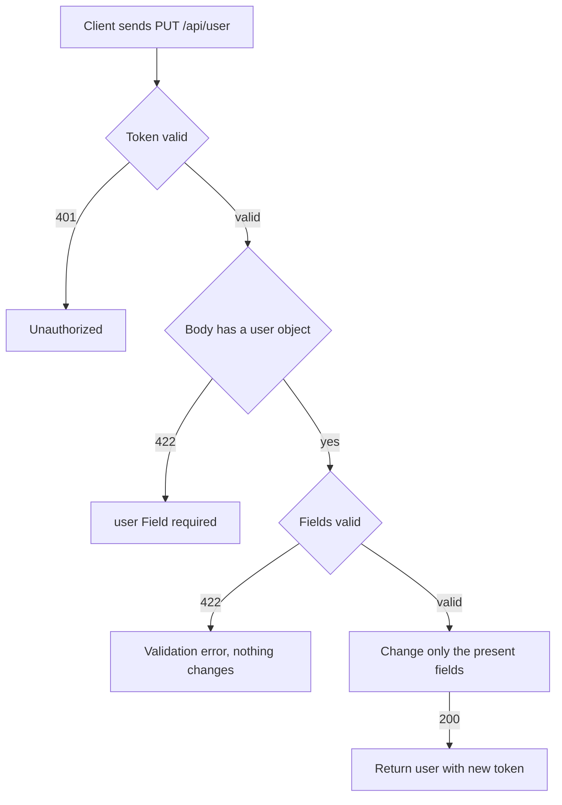

# Current user read and update
<!-- Read ../../index.md first. After changing this document, add an entry to ../../log.md -->

## Purpose
This document owns the account settings flow of a logged-in client: reading the current user with GET /api/user and changing it with PUT /api/user, until the server returns the user with a new token. It does not cover the public profile that other users see, which [Profile view](profile-view.md) owns, or token validation, which [API transport, authentication, and errors](../transport-and-errors.md) owns.

## Current behavior
### Reading the current user
- Both endpoints are protected; without a valid token the server answers 401, as [Protected endpoint without token](../transport-and-errors.md#protected-endpoint-without-token) describes.
- With a valid token, GET /api/user answers 200 with a "user" object holding "username", "email", "bio", "image", and "token".
- The server writes "bio" and "image" as null when they are empty.
- The "token" is newly issued on every read, not the token the client sent.

### Sending an update
- The client sends PUT /api/user with a JSON body whose "user" object holds any subset of "email", "username", "bio", "image", and "password".
- The server changes only the fields present in the "user" object and keeps every other field, so the endpoint behaves as a partial update.
- If "password" is present, the server stores the new password as a hash and does not return it.
- If the body has no "user" object or is not a JSON object, the server answers 422 with a "Field required" error on "user".
- If the body holds keys other than "user", the server ignores them.
- If "user" is not a JSON object, for example a list, the server answers 200 and changes nothing.

### Update validation
- If "email" is not a valid email address, the server answers 422 and changes nothing.
- If "email", "username", or "password" is an empty string or null, the server answers 422 with the message "can't be blank".
- If "bio" or "image" is null, the server stores it as empty, and the response shows null.
- If "password" has from 1 to 7 characters, the server answers 422 with the message "must be at least 8 characters long".
- If the new email or username is already used by another account, the server does not handle the database error and returns no defined answer.

### Update response
- On success the server answers 200 with the same "user" object as a read, holding the updated values and a newly issued "token".

## Flow
The diagram shows the outcomes of an update request.

A read follows only the token check and ends in 200 with a new token. An update changes nothing unless every present field is valid.

## Policies
### Current user read
GET /api/user requires a valid token and answers 200 with "username", "email", "bio" as null when empty, "image" as null when empty, and a newly issued "token".

### Current user partial update
PUT /api/user changes only the fields among "email", "username", "bio", and "image" that the "user" object contains, keeps the others, and answers 200 with the updated user and a newly issued token.

### Current user password change
If the "user" object contains "password", the server stores the new password as a hash so that the new password authenticates the account, and the response does not include the password.

### Current user update body shape
If the body has no "user" object or is not a JSON object, the server answers 422 with a "Field required" error on "user". Keys outside "user" are ignored. If "user" is not a JSON object, the server answers 200 and changes nothing.

### Current user email validation
If "email" in an update is not a valid email address, the server answers 422.

### Current user blank and null values
If "email", "username", or "password" in an update is an empty string or null, the server answers 422 with the message "can't be blank". If "bio" or "image" is null, the server stores it as empty and the response shows null.
[needs confirmation] No test sends an empty or null value in an update; are these answers intended, and should null clear "bio" and "image"?

### Current user password minimum length
If "password" in an update has from 1 to 7 characters, the server answers 422 with the message "must be at least 8 characters long". The code comment cites NIST 800-63B section 5.1.1.2 as the basis.
[needs confirmation] No test sends a short password; is the 8-character minimum the intended rule for updates, and should registration apply it too?

### Current user update duplicate email or username
If an update sets an email or username that another account already uses, the server does not catch the database error, so it returns no defined answer, unlike registration, which answers 409.
[needs confirmation] What should the server answer when an update collides with another account's email or username?

## Evidence
- `apps/accounts/api.py:63-82` — read and update endpoints: token required, partial update loop, password hashing, new token in the response
- `apps/accounts/schemas.py:87-107` — user output: "bio" and "image" written as null when empty, token from the context
- `apps/accounts/schemas.py:114-138` — update body: optional fields, null converted to empty, "can't be blank" rule, 8-character password minimum
- `helpers/empty.py:6-15` — marker that distinguishes an absent field from null
- `apps/accounts/tests.py:160-319` — read, read without token, every combination of field updates, password change, body shape cases, invalid email, update without token

## Open questions
- [needs confirmation] [Current user blank and null values](#current-user-blank-and-null-values) — No test sends an empty or null value in an update; are these answers intended, and should null clear "bio" and "image"?
- [needs confirmation] [Current user password minimum length](#current-user-password-minimum-length) — No test sends a short password; is the 8-character minimum the intended rule for updates, and should registration apply it too?
- [needs confirmation] [Current user update duplicate email or username](#current-user-update-duplicate-email-or-username) — What should the server answer when an update collides with another account's email or username?

## Related
- [Accounts API overview](overview.md)
- [User registration](registration.md)
- [User login](login.md)
- [Profile view](profile-view.md)
- [API transport, authentication, and errors](../transport-and-errors.md)
