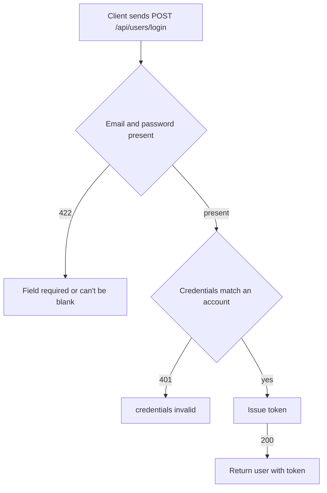

# User login
<!-- Read ../../index.md first. After changing this document, add an entry to ../../log.md -->

## Purpose
This document owns the login flow, POST /api/users/login, from the client sending an email and password until the server returns the user with a new token or rejects the credentials. It does not cover creating an account, which [User registration](registration.md) owns, or the token format, which [API transport, authentication, and errors](../transport-and-errors.md) owns.

## Current behavior
### Login request
- The client sends a JSON body whose "user" object holds "email" and "password".
- The endpoint is public and does not read the Authorization header.
- The server identifies the account by its email, not by its username.

### Login validation
- If the "user" object lacks "email" or "password", the server answers 422 with a "Field required" error for each missing field.
- If "email" or "password" is an empty string, the server answers 422 with the message "can't be blank".

### Credential check
- If the email and password do not match an account, the server answers 401 with `{"errors": {"credentials": ["invalid"]}}`.
- The server gives the same answer for an unknown email and for a wrong password.

### Successful login
- On success the server answers 200 with a "user" object holding "username", "email", "bio", "image", and a newly issued "token".
- The server writes "bio" and "image" as null when they are empty.

## Flow
The diagram shows the outcomes of a login request.

A request ends in 422 when a field is missing or blank, in 401 when the credentials do not match, and in 200 with a token otherwise.

## Policies
### Login required fields
If the "user" object lacks "email" or "password", the server answers 422 with a "Field required" error for each missing field.

### Login identifier
The server identifies the account to log in by its email and the password.

### Login wrong password
If the password does not match the account of the given email, the server answers 401 with `{"errors": {"credentials": ["invalid"]}}`.

### Login response
On success the server answers 200 with a "user" object holding "username", "email", "bio" as null when empty, "image" as null when empty, and a newly issued "token".

### Login rejection without a test
If "email" or "password" is an empty string, the server answers 422 with the message "can't be blank". If the email belongs to no account, the server answers 401 with `{"errors": {"credentials": ["invalid"]}}`, the same as for a wrong password.
[needs confirmation] No test covers an empty field or an unknown email; are these answers the intended contract?

## Evidence
- `apps/accounts/api.py:46-60` — login endpoint: credential check, 401 credentials invalid, 200 response with token
- `apps/accounts/schemas.py:70-84` — login body: required "user" object with "email" and "password", "can't be blank" rule
- `apps/accounts/models.py:41-43` — email is the login identifier
- `apps/accounts/tests.py:113-157` — login success, wrong password, missing password, missing email and password

## Open questions
- [needs confirmation] [Login rejection without a test](#login-rejection-without-a-test) — No test covers an empty field or an unknown email; are these answers the intended contract?

## Related
- [Accounts API overview](overview.md)
- [User registration](registration.md)
- [Current user read and update](current-user.md)
- [API transport, authentication, and errors](../transport-and-errors.md)
