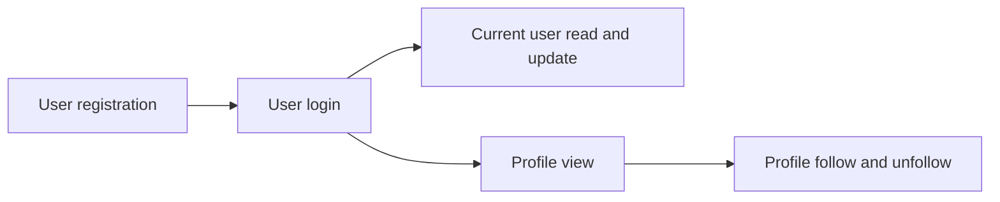

# Accounts API
<!-- Read ../../index.md first. After changing this document, add an entry to ../../log.md -->

## Purpose
This area owns the account endpoints: registering, logging in, reading and updating the current user, viewing a profile, and following or unfollowing a user. It does not cover token validation and the error body, which [API transport, authentication, and errors](../transport-and-errors.md) owns, or the operator command that creates users, which [Create user command](../../operations/create-user-command.md) owns.

## Flow
The diagram shows the order in which a client meets the account documents.

A client starts with registration or login, then manages its own account or views other users' profiles and follows them.

## Documents
- [User registration](registration.md) — creating an account and returning it with a token
- [User login](login.md) — checking email and password and returning the user with a token
- [Current user read and update](current-user.md) — reading and partially updating the logged-in user's account
- [Profile view](profile-view.md) — viewing a public profile and the profile representation reused for authors
- [Profile follow and unfollow](profile-follow.md) — following and unfollowing another user

## Terms
- Username(name) — [Create user command field names](../../operations/create-user-command.md#create-user-command-field-names)
- Profile(author) — [Profile representation](profile-view.md#profile-representation)

## Related
- [API overview](../overview.md)
- [Spec index](../../index.md)
