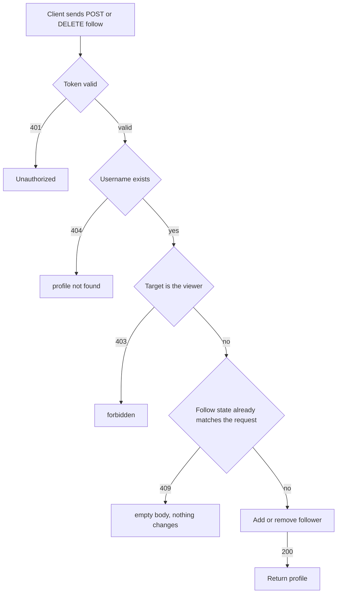

# Profile follow and unfollow
<!-- Read ../../index.md first. After changing this document, add an entry to ../../log.md -->

## Purpose
This document owns following a user with POST /api/profiles/{username}/follow and unfollowing with DELETE /api/profiles/{username}/follow, until the server returns the updated profile. It does not cover the profile representation, which [Profile view](profile-view.md) owns, or which articles appear in the feed of followed authors, which [Article list and feed](../articles/article-list-and-feed.md) owns.

## Current behavior
### Follow request
- Both endpoints are protected; without a valid token the server answers 401, as [Protected endpoint without token](../transport-and-errors.md#protected-endpoint-without-token) describes.
- If no user has the requested username, the server answers 404 with the resource name "profile".
- If the requested username is the viewer's own, the server answers 403 and changes nothing.

### Following
- If the viewer does not follow the user yet, POST records the viewer as a follower and answers 200 with the profile, whose "following" is true.
- If the viewer already follows the user, POST answers 409 with an empty body and changes nothing.

### Unfollowing
- If the viewer follows the user, DELETE removes the viewer from the followers and answers 200 with the profile, whose "following" is false.
- If the viewer does not follow the user, DELETE answers 409 with an empty body and changes nothing.

## Flow
The diagram shows the checks that a follow or unfollow request passes.

A request changes data only when it reaches the last step; every other branch leaves the follow relation unchanged.

## Policies
### Follow a profile
If the viewer does not follow the user, POST /api/profiles/{username}/follow records the viewer as a follower and answers 200 with the profile, whose "following" is true.

### Unfollow a profile
If the viewer follows the user, DELETE /api/profiles/{username}/follow removes the viewer from the followers and answers 200 with the profile, whose "following" is false.

### Follow state conflict
If the viewer already follows the user, POST answers 409. If the viewer does not follow the user, DELETE answers 409. Neither changes the follow relation.

### Self follow
If the requested username is the viewer's own, both POST and DELETE answer 403.

### Follow unknown profile
If no user has the requested username, POST answers 404. DELETE uses the same lookup.

## Evidence
- `apps/accounts/api.py:92-115` — follow and unfollow endpoints: 404 lookup, 403 for the viewer's own profile, 409 when the state already matches, follower added or removed
- `apps/accounts/models.py:39` — followers relation
- `apps/accounts/tests.py:357-405` — follow, follow twice, unfollow, unfollow without token, unfollow when not following, self follow and unfollow, unknown username

## Open questions
None

## Related
- [Accounts API overview](overview.md)
- [Profile view](profile-view.md)
- [Article list and feed](../articles/article-list-and-feed.md)
- [API transport, authentication, and errors](../transport-and-errors.md)
- [Article favorite and unfavorite](../articles/article-favorite.md)
