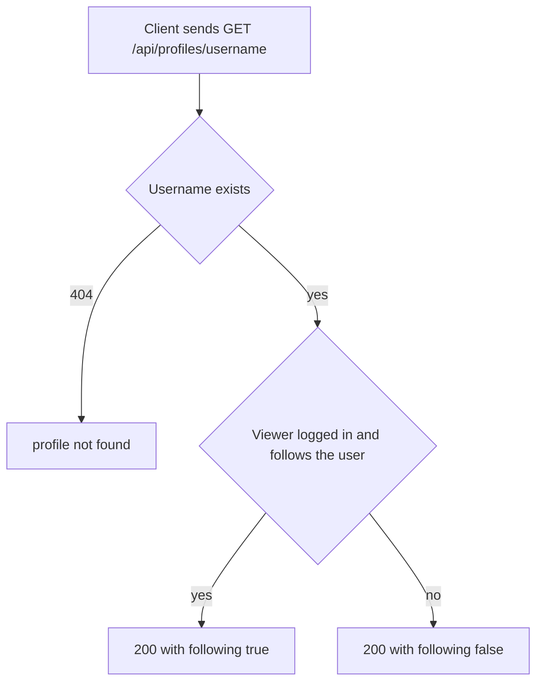

# Profile view
<!-- Read ../../index.md first. After changing this document, add an entry to ../../log.md -->

## Purpose
This document owns viewing a user's public profile with GET /api/profiles/{username} and the profile representation that articles and comments reuse for their authors. It does not cover following or unfollowing, which [Profile follow and unfollow](profile-follow.md) owns, or the logged-in user's own account data, which [Current user read and update](current-user.md) owns.

## Current behavior
### Profile lookup
- The endpoint is optional-auth, as [API transport, authentication, and errors](../transport-and-errors.md) describes.
- The server finds the user whose username equals the path value exactly.
- If no user has that username, the server answers 404 with the resource name "profile".
- If the user exists, the server answers 200 with a "profile" object.

### Profile fields
- A profile holds "username", "bio", "image", and "following".
- The server writes "bio" and "image" as null when they are empty.
- If the viewer is logged in and follows the user, "following" is true.
- If the viewer does not follow the user, views their own profile, or is anonymous, "following" is false.
- Articles and comments show their author with the same representation.

## Flow
The diagram shows how the server answers a profile request.

The "following" flag is the only part of the answer that depends on the viewer.

## Policies
### Profile representation
A profile holds "username", "bio", "image", and "following", and the server writes "bio" and "image" as null when they are empty. Articles and comments show their author with this representation.

### Profile following flag
"following" is true only when the viewer is logged in and follows the profile's user. It is false for an anonymous viewer, for a viewer who does not follow the user, and for a viewer looking at their own profile.

### Profile view unknown username
If no user has the requested username, the server answers 404 with the resource name "profile".
[needs confirmation] No test requests the profile of an unknown username; is 404 with the resource name "profile" the intended answer?

## Evidence
- `apps/accounts/api.py:85-89` — profile endpoint with optional authentication and 404 lookup
- `apps/accounts/schemas.py:16-48` — profile representation, "following" computed from the viewer, "bio" and "image" written as null when empty
- `apps/accounts/models.py:39` — followers relation, one direction per follow
- `apps/accounts/tests.py:322-355` — own profile, profile without login, followed and not followed profiles

## Open questions
- [needs confirmation] [Profile view unknown username](#profile-view-unknown-username) — No test requests the profile of an unknown username; is 404 with the resource name "profile" the intended answer?

## Related
- [Accounts API overview](overview.md)
- [Profile follow and unfollow](profile-follow.md)
- [Current user read and update](current-user.md)
- [Article read and representation](../articles/article-read.md)
- [Comment list](../comments/comment-list.md)
- [API transport, authentication, and errors](../transport-and-errors.md)
