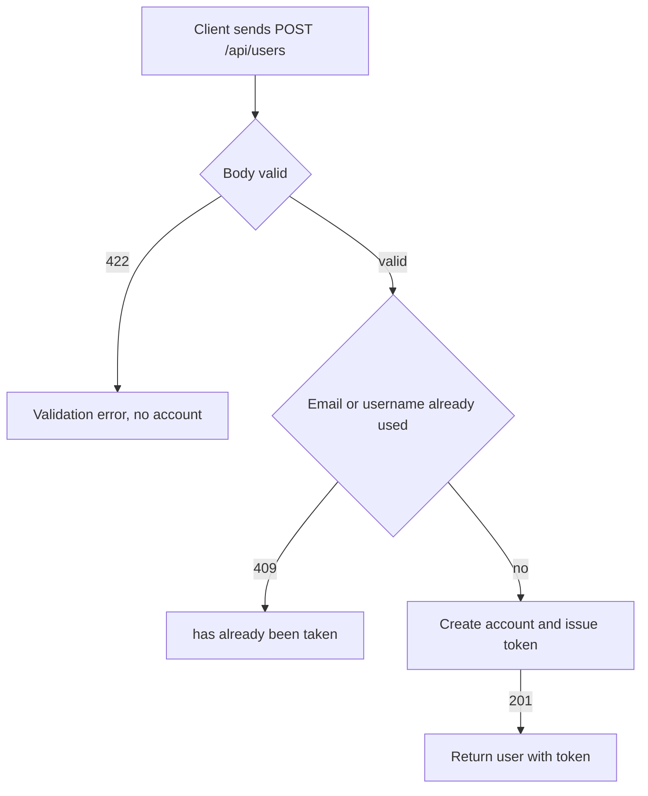

# User registration
<!-- Read ../../index.md first. After changing this document, add an entry to ../../log.md -->

## Purpose
This document owns the registration flow, POST /api/users, from the client sending a new account's email, username, and password until the server returns the new user with a token. It does not cover logging in to an existing account, which [User login](login.md) owns, or the token format, which [API transport, authentication, and errors](../transport-and-errors.md) owns.

## Current behavior
### Registration request
- The client sends a JSON body whose "user" object holds "email", "username", and "password".
- The endpoint is public and does not read the Authorization header.

### Registration validation
- If the body has no "user" object, the server answers 422 and creates no account.
- If the "user" object lacks "email", "username", or "password", the server answers 422 and creates no account.
- If "email", "username", or "password" is an empty string, the server answers 422 with the message "can't be blank" and creates no account.
- If "email" is not a valid email address, the server answers 422 and creates no account.
- The server accepts any non-empty password; it applies no length or strength rule at registration.

### Account creation
- The server creates an active account that is neither staff nor superuser, with an empty bio, no image, and no last login time.
- The server stores the password as a hash, using the algorithm that [Password hashing algorithm](../../operations/startup-configuration.md#password-hashing-algorithm) describes.
- If another account already uses the email, the server answers 409 with `{"errors": {"email": ["has already been taken"]}}` and creates no account.
- If another account already uses the username, the server answers 409 with `{"errors": {"username": ["has already been taken"]}}` and creates no account.
- If the database rejects the account as a duplicate and the server cannot tell which field caused it, the server answers 409 with the field name "unknown".

### Successful registration
- On success the server answers 201 with a "user" object holding "username", "email", "bio", "image", and "token".
- The server writes "bio" and "image" as null when they are empty, so a new account always shows null for both.
- The token is a newly issued token, as [Issued token format](../transport-and-errors.md#issued-token-format) describes.

## Flow
The diagram shows the outcomes of a registration request.

A request ends in 422 when the body shape or a field is invalid, in 409 when the email or username is taken, and in 201 with a token otherwise.

## Policies
### Registration required fields
If the body has no "user" object, or the "user" object lacks "email", "username", or "password", the server answers 422 and creates no account. If any of the three fields is an empty string, the server answers 422 with the message "can't be blank" and creates no account.

### Registration email format
The server validates "email" as an email address and answers 422 for an invalid address. The test named for a wrong email sends the fields without the "user" object, so it fails on the missing object rather than on the email format.
[needs confirmation] No test sends a malformed email inside the "user" object; is rejecting it with 422 the intended contract, and which addresses count as invalid?

### Registration duplicate email or username
If the email or the username is already used by another account, the server answers 409 with `{"errors": {"<field>": ["has already been taken"]}}`, where the field is "email" or "username", and creates no account.

### Registration response
On success the server answers 201 with a "user" object holding "username", "email", "bio" as null, "image" as null, and a newly issued "token".

### Registered account initial state
A new account is active, is neither staff nor superuser, has an empty bio, no image, and no last login time, and stores its password as a hash.

### Registration password strength
The server accepts any non-empty password at registration. The settings configure the similarity, minimum length, common password, and numeric password validators, but registration does not run them, while updating the current user requires at least 8 characters ([Current user password minimum length](current-user.md#current-user-password-minimum-length)).
[needs confirmation] Should registration enforce a password rule, and if so, which one: the configured validators or the 8-character minimum used on update?

### Registration username length
The account model limits "username" to 60 characters and the email field to 254 characters, but the request validation applies no length limit, so the result for a longer value depends on the database.
[needs confirmation] What should the server answer when "username" is longer than 60 characters or "email" is longer than 254 characters?

## Evidence
- `apps/accounts/api.py:27-43` — registration endpoint: account creation, 409 on a duplicate field, 201 response with token
- `apps/accounts/schemas.py:51-67` — registration body: required "user" object, email validation, "can't be blank" rule
- `apps/accounts/models.py:7-15` — create_user stores a hashed password or an unusable one
- `apps/accounts/models.py:29-45` — unique email and username, 60-character username, empty bio, optional image, email as login identifier
- `apps/accounts/migrations/0001_initial.py:50` — email column limited to 254 characters
- `helpers/exceptions.py:22-31` — clean_integrity_error extracts the duplicate field name from PostgreSQL and SQLite errors
- `config/settings.py:117-122` — configured password validators
- `apps/accounts/tests.py:17-110` — registration success, stored account values, duplicate email and username, missing and empty fields

## Open questions
- [needs confirmation] [Registration email format](#registration-email-format) — No test sends a malformed email inside the "user" object; is rejecting it with 422 the intended contract, and which addresses count as invalid?
- [needs confirmation] [Registration password strength](#registration-password-strength) — Should registration enforce a password rule, and if so, which one: the configured validators or the 8-character minimum used on update?
- [needs confirmation] [Registration username length](#registration-username-length) — What should the server answer when "username" is longer than 60 characters or "email" is longer than 254 characters?

## Related
- [Accounts API overview](overview.md)
- [User login](login.md)
- [Current user read and update](current-user.md)
- [API transport, authentication, and errors](../transport-and-errors.md)
- [Server startup configuration](../../operations/startup-configuration.md)
- [Create user command](../../operations/create-user-command.md)
