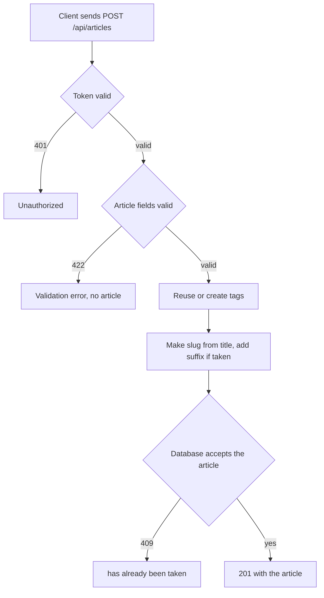

# Article creation
<!-- Read ../../index.md first. After changing this document, add an entry to ../../log.md -->

## Purpose
This document owns publishing a new article with POST /api/articles, from the client sending the title, description, body, and tags until the server returns the created article, and owns how an article's slug is made from its title. It does not cover changing an existing article, which [Article update](article-update.md) owns, or the article fields in the response, which [Article read and representation](article-read.md) owns.

## Current behavior
### Article request
- The endpoint is protected; without a valid token the server answers 401, as [Protected endpoint without token](../transport-and-errors.md#protected-endpoint-without-token) describes.
- The client sends a JSON body whose "article" object holds "title", "description", "body", and optionally "tagList".
- The server ignores keys in the "article" object other than these four.

### Article validation
- If "title", "description", or "body" is missing, the server answers 422 and creates no article.
- If "title", "description", or "body" is an empty string, the server answers 422 with the message "can't be blank".
- If "tagList" is present and is not a list of strings, the server answers 422.

### Tags
- For each name in "tagList", the server reuses the tag with that name or creates it.
- If "tagList" is absent, the article has no tags.

### Slug
- The server makes the slug from the title by lowercasing it and joining its words with hyphens, for example "New Test Title" becomes "new-test-title".
- If another article already has that slug, the server appends a hyphen and 8 random hexadecimal characters.
- Two articles may have the same title.

### Article response
- On success the server answers 201 with an "article" object in the representation that [Article representation fields](article-read.md#article-representation-fields) describes.
- A new article shows "favorited" as false, "favoritesCount" as 0, and the viewer as "author" with "following" false.
- If the database rejects the article as a duplicate, the server answers 409 with `{"errors": {"<field>": ["has already been taken"]}}` and reports a slug conflict under "title".

## Flow
The diagram shows the outcomes of an article creation request.

Validation and the token check end the request before any tag or article is written; a 409 is possible only when the database rejects the article.

## Policies
### Article creation required fields
If "title" is missing or empty, the server answers 422 and creates no article.

### Article creation blank description or body
If "description" or "body" is missing or an empty string, the server answers 422, with the message "can't be blank" for an empty string, and creates no article.
[needs confirmation] No test sends a missing or empty "description" or "body"; is rejecting them the intended contract?

### Article tag list input
The server reuses or creates a tag for each name in "tagList" and attaches the tags to the article. If "tagList" is absent, the article has no tags. If "tagList" is not a list, the server answers 422.

### Article unknown input fields
The server ignores keys in the "article" object that it does not know, on both creation and update.

### Article slug from title
The server makes the slug from the title by lowercasing it and joining its words with hyphens, both when it creates an article and when an update changes the title.

### Article slug collision suffix
If another article already has the slug made from the title, the server appends a hyphen and 8 random hexadecimal characters to it. Titles are not unique, so two articles with the same title get different slugs.
[needs confirmation] No test creates two articles with the same title; is the random 8-character suffix the intended way to keep slugs unique, or should a repeated title be rejected?

### Article creation response
On success the server answers 201 with the created article, whose "favorited" is false, "favoritesCount" is 0, and "author" is the viewer's profile with "following" false.

### Article creation conflict
If the database rejects the new article as a duplicate, the server answers 409 with `{"errors": {"<field>": ["has already been taken"]}}`, and reports a conflict on the slug under "title". Because the slug suffix avoids slug conflicts and titles are not unique, the code shows no ordinary request that reaches this branch.
[needs confirmation] Which request should produce 409 on article creation, or is this branch no longer needed?

### Article title length
The article model limits "title" to 150 characters, but the request validation applies no length limit, so the result for a longer title depends on the database.
[needs confirmation] What should the server answer when "title" is longer than 150 characters?

## Evidence
- `apps/articles/api.py:71-90` — creation endpoint: token required, tag reuse or creation, transaction, 409 with slug reported as title, 201 response
- `apps/articles/schemas.py:42-57` — creation body: required fields, "can't be blank" rule, optional tag list
- `apps/articles/models.py:14-18` — tag with a unique name
- `apps/articles/models.py:36-55` — title limit of 150 characters, slug made from the title, random suffix on a slug conflict
- `apps/articles/migrations/0003_replace_taggit_with_tags.py:61-65` — title is no longer unique
- `helpers/exceptions.py:22-31` — extraction of the duplicate field name
- `apps/articles/tests.py:186-323` — creation with tags, without tags, empty title, missing title, unknown field, non-list tag list
- `apps/articles/tests.py:331-409` — slug made again from a changed title

## Open questions
- [needs confirmation] [Article creation blank description or body](#article-creation-blank-description-or-body) — No test sends a missing or empty "description" or "body"; is rejecting them the intended contract?
- [needs confirmation] [Article slug collision suffix](#article-slug-collision-suffix) — No test creates two articles with the same title; is the random 8-character suffix the intended way to keep slugs unique, or should a repeated title be rejected?
- [needs confirmation] [Article creation conflict](#article-creation-conflict) — Which request should produce 409 on article creation, or is this branch no longer needed?
- [needs confirmation] [Article title length](#article-title-length) — What should the server answer when "title" is longer than 150 characters?

## Related
- [Articles API overview](overview.md)
- [Article read and representation](article-read.md)
- [Article update](article-update.md)
- [Tag list](tag-list.md)
- [API transport, authentication, and errors](../transport-and-errors.md)
