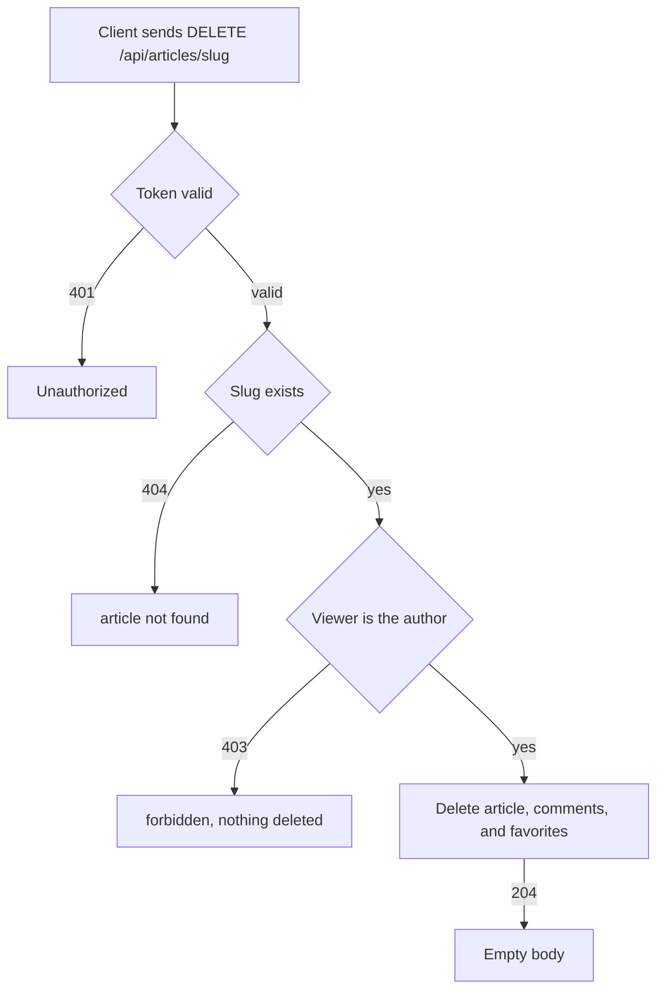

# Article deletion
<!-- Read ../../index.md first. After changing this document, add an entry to ../../log.md -->

## Purpose
This document owns an author deleting their article with DELETE /api/articles/{slug}, from the request until the server confirms the deletion. It does not cover deleting a single comment, which [Comment deletion](../comments/comment-delete.md) owns.

## Current behavior
### Deletion request
- The endpoint is protected; without a valid token the server answers 401 and deletes nothing, as [Protected endpoint without token](../transport-and-errors.md#protected-endpoint-without-token) describes.
- If no article has the slug, the server answers 404, as [Article lookup by unknown slug](article-read.md#article-lookup-by-unknown-slug) describes.
- If the viewer is not the article's author, the server answers 403 and deletes nothing.

### Deleting the article
- If the viewer is the author, the server deletes the article and answers 204 with an empty body.
- Deleting the article also deletes its comments and its favorite records.
- Deleting the article keeps its tags, which stay in the [Tag list](tag-list.md).

## Flow
The diagram shows the checks that a deletion request passes.

Only the author reaches the deletion step; every other branch leaves the article in place.

## Policies
### Article deletion author only
If the viewer is the article's author, the server deletes the article and answers 204 with an empty body. If the viewer is another user, the server answers 403, and without a token it answers 401; in both cases the article stays.

### Article deletion cascade
Deleting an article also deletes its comments and its favorite records, and keeps its tags.
[needs confirmation] No test checks what happens to comments, favorites, and tags when an article is deleted; is this the intended result?

## Evidence
- `apps/articles/api.py:99-106` — deletion endpoint: token required, author check, 204 with an empty body
- `apps/comments/models.py:6-11` — comments are deleted with their article
- `apps/articles/models.py:45-46` — tag and favorite relations of an article
- `apps/articles/tests.py:437-451` — deletion by the author, without token, and by another user

## Open questions
- [needs confirmation] [Article deletion cascade](#article-deletion-cascade) — No test checks what happens to comments, favorites, and tags when an article is deleted; is this the intended result?

## Related
- [Articles API overview](overview.md)
- [Article update](article-update.md)
- [Tag list](tag-list.md)
- [Comment deletion](../comments/comment-delete.md)
- [API transport, authentication, and errors](../transport-and-errors.md)
