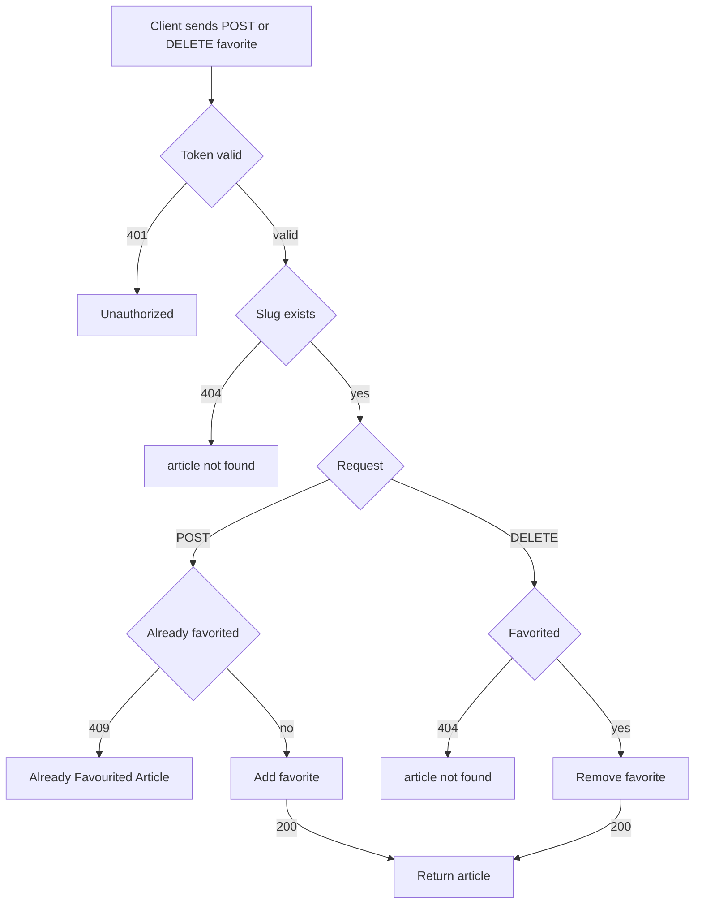

# Article favorite and unfavorite
<!-- Read ../../index.md first. After changing this document, add an entry to ../../log.md -->

## Purpose
This document owns a logged-in client marking an article as a favorite with POST /api/articles/{slug}/favorite and removing the mark with DELETE /api/articles/{slug}/favorite, until the server returns the updated article. It does not cover how "favorited" and "favoritesCount" are shown, which [Article favorited flag](article-read.md#article-favorited-flag) owns, or filtering the list by favorites, which [Article list filters](article-list-and-feed.md#article-list-filters) owns.

## Current behavior
### Favorite request
- Both endpoints are protected; without a valid token the server answers 401, as [Protected endpoint without token](../transport-and-errors.md#protected-endpoint-without-token) describes.
- If no article has the slug, the server answers 404, as [Article lookup by unknown slug](article-read.md#article-lookup-by-unknown-slug) describes.
- An author can favorite their own article.

### Favoriting
- If the viewer has not favorited the article, POST records the favorite and answers 200 with the article, whose "favorited" is true and whose "favoritesCount" has grown by 1.
- If the viewer has already favorited the article, POST answers 409 with `{"errors": {"body": ["Already Favourited Article"]}}`.

### Unfavoriting
- If the viewer has favorited the article, DELETE removes the favorite and answers 200 with the article, whose "favorited" is false and whose "favoritesCount" has shrunk by 1.
- If the viewer has not favorited the article, DELETE answers 404 with the resource name "article".

## Flow
The diagram shows the outcomes of a favorite or unfavorite request.

A repeated POST ends in 409 while a repeated DELETE ends in 404; only the first request of each kind changes the favorite.

## Policies
### Favorite an article
If the viewer has not favorited the article, POST /api/articles/{slug}/favorite records the favorite and answers 200 with the article, whose "favorited" is true and "favoritesCount" has grown by 1.

### Unfavorite an article
If the viewer has favorited the article, DELETE /api/articles/{slug}/favorite removes the favorite and answers 200 with the article, whose "favorited" is false and "favoritesCount" has shrunk by 1.

### Favorite an already favorited article
If the viewer has already favorited the article, POST answers 409 with `{"errors": {"body": ["Already Favourited Article"]}}`. The endpoint declares only 200 and 404 as its response codes, so the 409 answer is not part of its declared responses.
[needs confirmation] No test favorites an article twice; is 409 with this body the intended answer, and should the endpoint declare it?

### Unfavorite an article not favorited
If the viewer has not favorited the article, DELETE answers 404 with the resource name "article", unlike a repeated follow request, which answers 409.
[needs confirmation] No test unfavorites an article that is not favorited; is 404 the intended answer, or should it match the 409 of a repeated favorite?

## Evidence
- `apps/articles/api.py:18-36` — favorite and unfavorite endpoints: token required, 409 on a repeated favorite, 404 on unfavoriting an article that is not favorited, article returned with updated values
- `apps/articles/models.py:21-30` — favorites count and viewer favorited flag
- `apps/articles/tests.py:453-475` — favorite and unfavorite by the author

## Open questions
- [needs confirmation] [Favorite an already favorited article](#favorite-an-already-favorited-article) — No test favorites an article twice; is 409 with this body the intended answer, and should the endpoint declare it?
- [needs confirmation] [Unfavorite an article not favorited](#unfavorite-an-article-not-favorited) — No test unfavorites an article that is not favorited; is 404 the intended answer, or should it match the 409 of a repeated favorite?

## Related
- [Articles API overview](overview.md)
- [Article read and representation](article-read.md)
- [Article list and feed](article-list-and-feed.md)
- [Profile follow and unfollow](../accounts/profile-follow.md)
- [API transport, authentication, and errors](../transport-and-errors.md)
