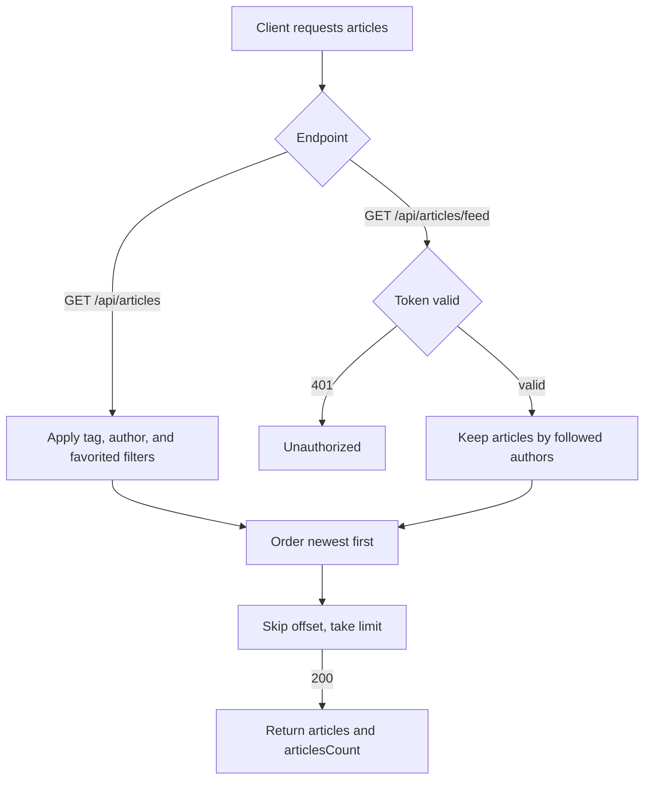

# Article list and feed
<!-- Read ../../index.md first. After changing this document, add an entry to ../../log.md -->

## Purpose
This document owns browsing articles: the global list with GET /api/articles and the feed of followed authors with GET /api/articles/feed, both paged and returned with a total count. It does not cover the fields of each article, which [Article read and representation](article-read.md) owns, or following an author, which [Profile follow and unfollow](../accounts/profile-follow.md) owns.

## Current behavior
### Global list
- GET /api/articles is public and does not read the Authorization header.
- The client may filter by "tag" (a tag name), "author" (the author's username), and "favorited" (the username of a user who favorited the article).
- If the client gives two or more filters, the server returns only articles that match all of them.
- If no article matches, the server answers 200 with an empty list.

### Viewer of the global list
- The global list computes "favorited" and the author's "following" for the user of the Django session, because the endpoint does not read the token.
- If the client sends only a token, the server treats it as an anonymous viewer, so "favorited" and "following" are false for every article.

### Feed
- GET /api/articles/feed is protected; without a valid token the server answers 401, as [Protected endpoint without token](../transport-and-errors.md#protected-endpoint-without-token) describes.
- The feed holds only articles whose author the viewer follows.
- If the viewer follows nobody, the feed is empty.

### Paging and order
- Both endpoints order articles from newest to oldest by creation time.
- Both endpoints take "limit" and "offset": they skip "offset" articles and return at most "limit" articles.
- If the client omits them, "limit" is 20 and "offset" is 0.
- The server applies no upper bound to "limit" and no lower bound to either value.

### List response
- Both endpoints answer 200 with "articles" and "articlesCount".
- "articlesCount" is the number of all matching articles, regardless of "limit" and "offset".
- Each item in "articles" has every article field except "body".

## Flow
The diagram shows how each endpoint chooses its articles before paging.

| Endpoint | Authentication kind | Articles included | Viewer for favorited and following |
| --- | --- | --- | --- |
| GET /api/articles | public | all articles matching the filters | Django session user, anonymous when only a token is sent |
| GET /api/articles/feed | protected | articles by authors the viewer follows | token user |

The feed is the only one of the two that can answer 401; both share the same order, paging, and response shape.

## Policies
### Article list filters
GET /api/articles keeps only articles with the given tag name when "tag" is set, only articles by the given username when "author" is set, and only articles favorited by the given username when "favorited" is set.

### Article list order
Both the global list and the feed order articles from newest to oldest by creation time.

### Article list pagination
Both the global list and the feed skip "offset" articles and return at most "limit" articles.

### Article list default page size
If the client omits "limit" and "offset", the server uses 20 and 0. The server applies no upper bound to "limit" and no lower bound to either value.
[needs confirmation] What is the basis of the default of 20, and what should the server answer for a negative value or a very large "limit"?

### Article list item fields
Each article in the global list and the feed has every article field except "body".

### Article feed scope
GET /api/articles/feed requires a valid token and holds only articles whose author the viewer follows.

### Article feed total count
"articlesCount" in the feed is the number of all matching articles regardless of "limit" and "offset".

### Article list viewer identity
The global list does not read the token, so it computes "favorited" and the author's "following" for the Django session user, and a client that sends only a token sees both as false. The tests pass the user to the test client directly, which bypasses this.
[needs confirmation] Should the global list read the token as an optional-auth endpoint so that a logged-in client sees its own "favorited" and "following" values?

## Evidence
- `apps/articles/api.py:39-47` — feed: token required, followed authors only, newest first, limit and offset, total count
- `apps/articles/api.py:50-68` — global list: no token authentication, tag, author, and favorited filters, newest first, limit and offset with defaults of 20 and 0, total count
- `apps/articles/models.py:21-30` — favorites count and viewer favorited flag
- `apps/articles/schemas.py:38-39` — list representation without "body"
- `config/settings.py:51-61` — session authentication middleware that sets the Django session user
- `apps/articles/tests.py:75-112` — global list without filters, with each filter, with limit, with offset
- `apps/articles/tests.py:114-184` — feed content, limit, offset, total count, and 401 without a token

## Open questions
- [needs confirmation] [Article list default page size](#article-list-default-page-size) — What is the basis of the default of 20, and what should the server answer for a negative value or a very large "limit"?
- [needs confirmation] [Article list viewer identity](#article-list-viewer-identity) — Should the global list read the token as an optional-auth endpoint so that a logged-in client sees its own "favorited" and "following" values?

## Related
- [Articles API overview](overview.md)
- [Article read and representation](article-read.md)
- [Profile follow and unfollow](../accounts/profile-follow.md)
- [Tag list](tag-list.md)
- [API transport, authentication, and errors](../transport-and-errors.md)
- [Article favorite and unfavorite](article-favorite.md)
