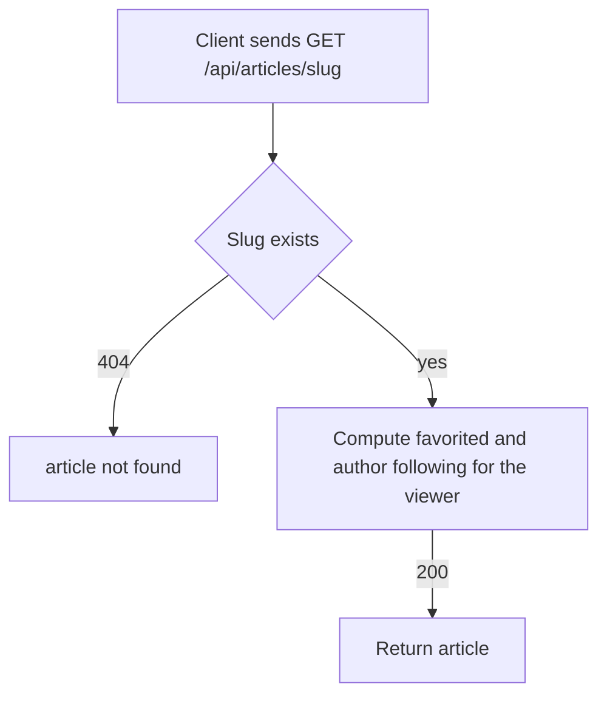

# Article read and representation
<!-- Read ../../index.md first. After changing this document, add an entry to ../../log.md -->

## Purpose
This document owns reading one article with GET /api/articles/{slug} and the article representation that every article endpoint returns. It does not cover listing articles, which [Article list and feed](article-list-and-feed.md) owns, or how the slug is made, which [Article creation](article-create.md) owns.

## Current behavior
### Article lookup
- The endpoint is optional-auth, as [API transport, authentication, and errors](../transport-and-errors.md) describes.
- The server finds the article whose slug equals the path value.
- If no article has that slug, the server answers 404 with the resource name "article".
- If the article exists, the server answers 200 with an "article" object.

### Article representation
- An article holds "slug", "title", "description", "body", "tagList", "createdAt", "updatedAt", "favorited", "favoritesCount", and "author".
- The "description" is the article's summary and the "body" is its full content.
- The "tagList" holds the names of the article's tags in alphabetical order, and is empty when the article has no tags.
- The "favoritesCount" is the number of users who favorited the article.
- If the viewer is logged in and has favorited the article, "favorited" is true; otherwise it is false.
- The "author" is the author's profile, as [Profile representation](../accounts/profile-view.md#profile-representation) describes, so its "following" flag depends on the viewer.
- The timestamps follow [Timestamp format](../transport-and-errors.md#timestamp-format).
- In a list, an article has every field except "body".

## Flow
The diagram shows how the server answers a request for one article.

The viewer changes only "favorited" and the author's "following" flag; every other field is the same for every viewer.

## Policies
### Article representation fields
An article holds "slug", "title", "description" from the summary, "body" from the content, "tagList", "createdAt", "updatedAt", "favorited", "favoritesCount", and "author" as a profile. The list representation omits "body" ([Article list item fields](article-list-and-feed.md#article-list-item-fields)).

### Article favorited flag
"favorited" is true when the viewer has favorited the article and false otherwise, and "favoritesCount" counts every user who favorited it.

### Article tag list order
The server sorts the names in "tagList" alphabetically. The tests check tag lists as sets or with a single tag.
[needs confirmation] Is alphabetical order the intended contract for "tagList", or should the order follow the order the author gave?

### Article lookup by unknown slug
If no article has the requested slug, the server answers 404 with the resource name "article". The read, update, delete, favorite, unfavorite, comment list, comment creation, and comment deletion endpoints use the same lookup.
[needs confirmation] No test requests an unknown slug; is 404 with the resource name "article" the intended answer for every one of these endpoints?

## Evidence
- `apps/articles/api.py:93-96` — article read endpoint with optional authentication and 404 lookup
- `apps/articles/schemas.py:11-39` — article representation: field names, alphabetical tag list, favorited flag, favorites count, list variant without "body"
- `apps/articles/models.py:21-30` — favorites count and viewer favorited flag, false for an anonymous viewer
- `apps/articles/models.py:36-49` — article fields, tags, favorites, unique slug
- `helpers/exceptions.py:15-19` — lookup that answers 404 with a resource name
- `apps/articles/tests.py:17-73` — expected article representation and timestamp check
- `apps/articles/tests.py:325-329` — article read
- `apps/articles/tests.py:453-475` — favorited flag and favorites count after favorite and unfavorite

## Open questions
- [needs confirmation] [Article tag list order](#article-tag-list-order) — Is alphabetical order the intended contract for "tagList", or should the order follow the order the author gave?
- [needs confirmation] [Article lookup by unknown slug](#article-lookup-by-unknown-slug) — No test requests an unknown slug; is 404 with the resource name "article" the intended answer for every one of these endpoints?

## Related
- [Articles API overview](overview.md)
- [Article list and feed](article-list-and-feed.md)
- [Article creation](article-create.md)
- [Article update](article-update.md)
- [Article deletion](article-delete.md)
- [Article favorite and unfavorite](article-favorite.md)
- [Profile view](../accounts/profile-view.md)
- [Comment list](../comments/comment-list.md)
- [Comment creation](../comments/comment-create.md)
- [Comment deletion](../comments/comment-delete.md)
