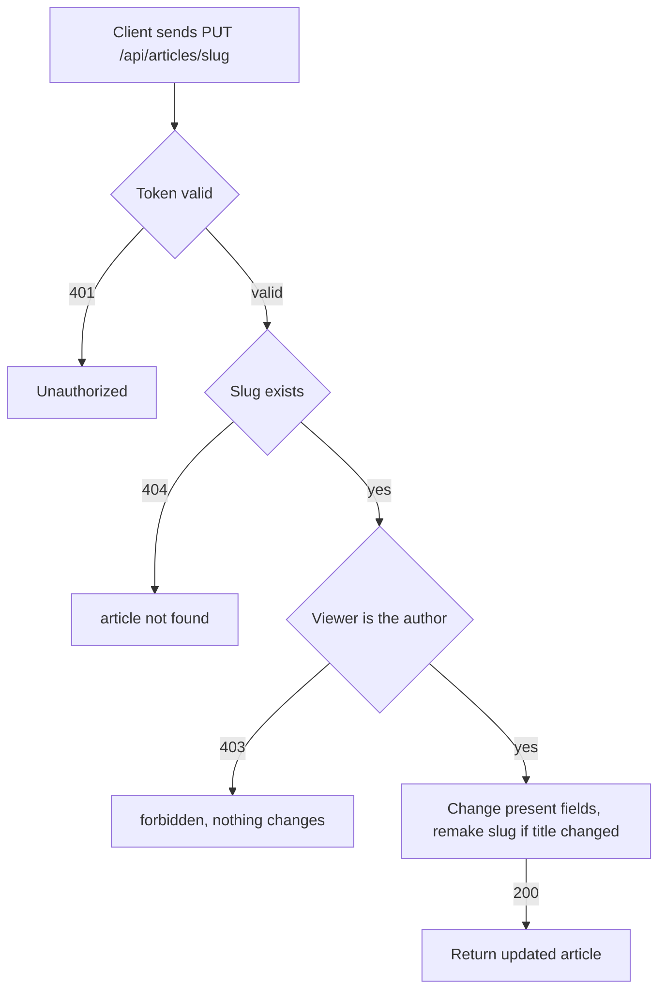

# Article update
<!-- Read ../../index.md first. After changing this document, add an entry to ../../log.md -->

## Purpose
This document owns an author changing their article with PUT /api/articles/{slug}, from the client sending the changed fields until the server returns the updated article. It does not cover how the slug is made from the title, which [Article creation](article-create.md) owns, or the article fields in the response, which [Article read and representation](article-read.md) owns.

## Current behavior
### Update request
- The endpoint is protected; without a valid token the server answers 401 and changes nothing, as [Protected endpoint without token](../transport-and-errors.md#protected-endpoint-without-token) describes.
- The client sends a JSON body whose "article" object holds any subset of "title", "description", "body", and "tagList".
- The server ignores keys in the "article" object that it does not know.
- If no article has the slug, the server answers 404, as [Article lookup by unknown slug](article-read.md#article-lookup-by-unknown-slug) describes.

### Author check
- If the viewer is not the article's author, the server answers 403 and changes nothing.

### Applying the change
- The server changes only the fields present in the "article" object and keeps every other field, so the endpoint behaves as a partial update.
- If the update changes "title", the server makes the slug again from the new title, so the article's address changes.
- If the update does not include "title", the slug stays the same.
- If "tagList" is present, the server replaces the article's tags with the given names, creating tags that do not exist yet.
- If "tagList" is absent, the article keeps its tags.
- Every successful update refreshes "updatedAt".
- If "title", "description", or "body" is an empty string, the server answers 422 with the message "can't be blank".

### Update response
- On success the server answers 200 with the updated article in the representation that [Article representation fields](article-read.md#article-representation-fields) describes.

## Flow
The diagram shows the checks that an update request passes before the article changes.

Only the author reaches the change step; a changed title also changes the slug that later requests must use.

## Policies
### Article partial update
The server changes only the fields among "title", "description", and "body" that the "article" object contains and keeps the others. The slug changes only when the title changes ([Article slug from title](article-create.md#article-slug-from-title)).

### Article update author only
If the viewer is not the article's author, the server answers 403 and changes nothing. Without a token the server answers 401 and changes nothing.

### Article update tag replacement
If "tagList" is present, the server replaces the article's tags with the given names, creating tags that do not exist yet, and an empty list removes every tag. If "tagList" is absent, the article keeps its tags.
[needs confirmation] No test checks the tags after an update with "tagList"; is replacing the whole tag set the intended contract?

### Article update blank and null values
If "title", "description", or "body" is an empty string, the server answers 422 with the message "can't be blank". If one of them is null, the validation accepts it and the server writes the null value, although the article columns do not allow null, so the result depends on the database.
[needs confirmation] What should the server answer when an update sets "title", "description", or "body" to an empty string or to null?

## Evidence
- `apps/articles/api.py:109-127` — update endpoint: token required, author check, partial update, slug and updated time saved with a title change, tag replacement
- `apps/articles/schemas.py:60-75` — update body: optional fields, "can't be blank" rule for empty strings, null accepted
- `apps/articles/models.py:36-55` — title, summary, and content without null, updated time, slug made again on save
- `apps/articles/tests.py:331-435` — full update, single-field updates, slug change only with a title change, unknown field, update without token, update by another user

## Open questions
- [needs confirmation] [Article update tag replacement](#article-update-tag-replacement) — No test checks the tags after an update with "tagList"; is replacing the whole tag set the intended contract?
- [needs confirmation] [Article update blank and null values](#article-update-blank-and-null-values) — What should the server answer when an update sets "title", "description", or "body" to an empty string or to null?

## Related
- [Articles API overview](overview.md)
- [Article creation](article-create.md)
- [Article read and representation](article-read.md)
- [Article deletion](article-delete.md)
- [API transport, authentication, and errors](../transport-and-errors.md)
