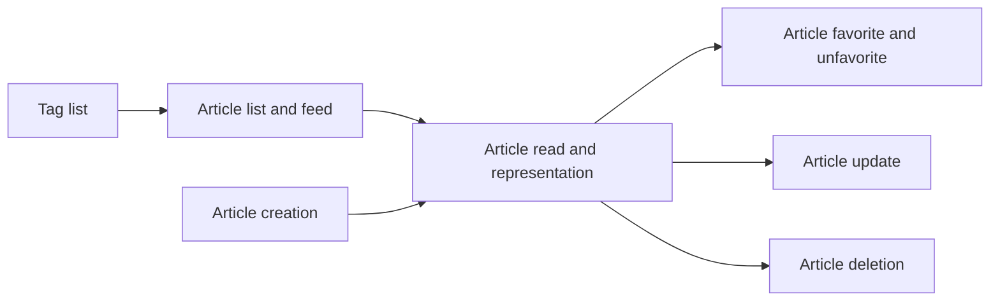

# Articles API
<!-- Read ../../index.md first. After changing this document, add an entry to ../../log.md -->

## Purpose
This area owns the article endpoints: listing articles and the feed, reading one article, creating, updating, and deleting an article, marking it as a favorite, and listing tags. It does not cover comments on an article, which [Comments API](../comments/overview.md) owns, or the author profile shown inside an article, which [Profile representation](../accounts/profile-view.md#profile-representation) owns.

## Flow
The diagram shows the order in which a client meets the article documents.

A reader browses tags and lists, opens an article, and may favorite it; an author creates an article and later updates or deletes it.

## Documents
- [Article list and feed](article-list-and-feed.md) — the global list with filters, the feed of followed authors, paging, and total count
- [Article read and representation](article-read.md) — reading one article and the article fields every article endpoint returns
- [Article creation](article-create.md) — publishing an article, its tags, and its slug
- [Article update](article-update.md) — an author changing their article
- [Article deletion](article-delete.md) — an author deleting their article
- [Article favorite and unfavorite](article-favorite.md) — marking and unmarking an article as a favorite
- [Tag list](tag-list.md) — listing every stored tag

## Terms
- Description(summary) — [Article representation fields](article-read.md#article-representation-fields)
- Body(content) — [Article representation fields](article-read.md#article-representation-fields)
- Tag list(tagList, tags) — [Article tag list input](article-create.md#article-tag-list-input)

## Related
- [API overview](../overview.md)
- [Spec index](../../index.md)
