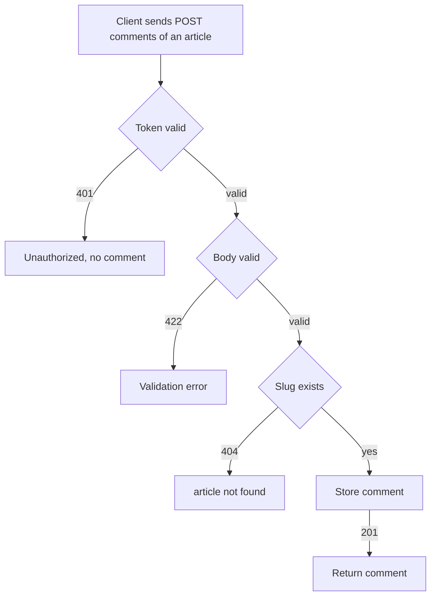

# Comment creation
<!-- Read ../../index.md first. After changing this document, add an entry to ../../log.md -->

## Purpose
This document owns a logged-in client writing a comment on an article with POST /api/articles/{slug}/comments, until the server returns the created comment. It does not cover the comment fields in the response, which [Comment representation](comment-list.md#comment-representation) owns.

## Current behavior
### Comment request
- The endpoint is protected; without a valid token the server answers 401 and creates no comment, as [Protected endpoint without token](../transport-and-errors.md#protected-endpoint-without-token) describes.
- The client sends a JSON body whose "comment" object holds "body".
- If no article has the slug, the server answers 404, as [Article lookup by unknown slug](../articles/article-read.md#article-lookup-by-unknown-slug) describes.

### Comment validation
- If the "comment" object or its "body" is missing, the server answers 422 and creates no comment.
- If "body" is an empty string, the server answers 422 with the message "can't be blank".

### Comment response
- On success the server stores the comment with the viewer as its author and answers 201 with a "comment" object.
- The comment's author is the viewer's own profile with "following" false.

## Flow
The diagram shows the outcomes of a comment creation request.

A comment is stored only after the token, the body, and the article all pass their checks.

## Policies
### Comment creation
POST /api/articles/{slug}/comments stores a comment on the article with the viewer as its author and answers 201 with the comment, whose author is the viewer's profile with "following" false. Without a token the server answers 401 and creates no comment.

### Comment body validation
If the "comment" object or its "body" is missing, the server answers 422. If "body" is an empty string, the server answers 422 with the message "can't be blank".
[needs confirmation] No test sends a missing or empty comment body; is rejecting it with 422 the intended contract?

## Evidence
- `apps/comments/api.py:43-56` — comment creation endpoint: token required, 404 lookup, viewer as author, 201 response
- `apps/comments/schemas.py:10-22` — comment body with the "can't be blank" rule
- `apps/comments/tests.py:89-124` — creation and creation without token

## Open questions
- [needs confirmation] [Comment body validation](#comment-body-validation) — No test sends a missing or empty comment body; is rejecting it with 422 the intended contract?

## Related
- [Comments API overview](overview.md)
- [Comment list](comment-list.md)
- [Comment deletion](comment-delete.md)
- [API transport, authentication, and errors](../transport-and-errors.md)
