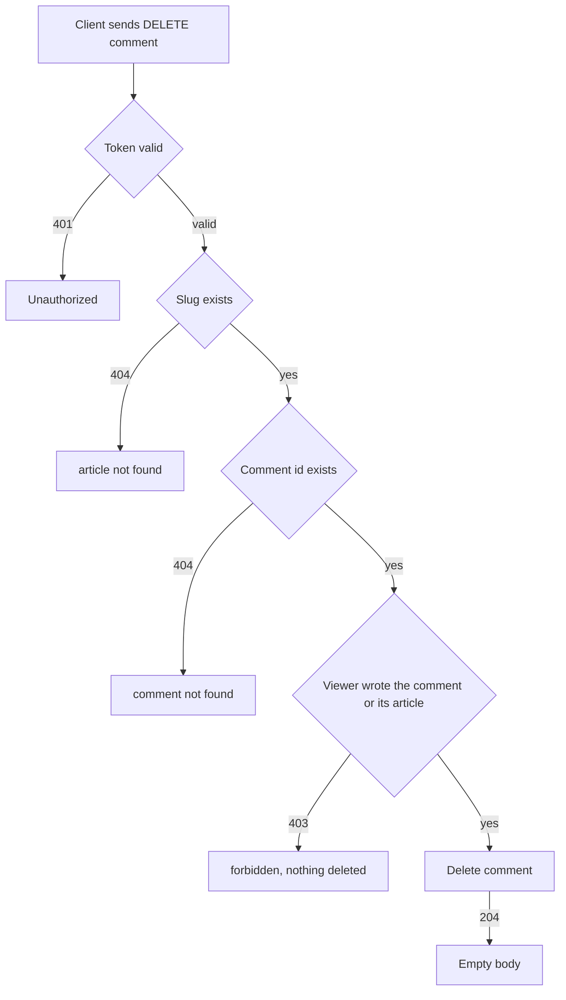

# Comment deletion
<!-- Read ../../index.md first. After changing this document, add an entry to ../../log.md -->

## Purpose
This document owns removing a comment with DELETE /api/articles/{slug}/comments/{id}, until the server confirms the deletion. It does not cover deleting a whole article with its comments, which [Article deletion](../articles/article-delete.md) owns.

## Current behavior
### Deletion request
- The endpoint is protected; without a valid token the server answers 401 and deletes nothing, as [Protected endpoint without token](../transport-and-errors.md#protected-endpoint-without-token) describes.
- If no article has the slug, the server answers 404, as [Article lookup by unknown slug](../articles/article-read.md#article-lookup-by-unknown-slug) describes.
- If no comment has the id, the server answers 404 with the resource name "comment".
- The server does not check that the comment belongs to the article in the path.

### Permission check
- If the viewer wrote the comment, the viewer may delete it.
- If the viewer wrote the article that the comment belongs to, the viewer may delete it, even when another user wrote the comment.
- If the viewer is neither, the server answers 403 and deletes nothing.

### Deleting the comment
- If the viewer may delete the comment, the server deletes it and answers 204 with an empty body.

## Flow
The diagram shows the checks that a comment deletion request passes.

| Viewer | Comment on own article | Comment on another user's article |
| --- | --- | --- |
| Comment author | 204 | 204 |
| Article author | 204 | None |
| Other user | 403 | 403 |

The article author and the comment author can both delete a comment; every other logged-in user gets 403.

## Policies
### Comment deletion permission
The comment author and the author of the comment's article may delete the comment, and the server answers 204 with an empty body. Any other logged-in user gets 403 and the comment stays. Without a token the server answers 401 and the comment stays.

### Comment deletion article match
The server checks that the slug names an existing article and that the id names an existing comment, but not that the comment belongs to that article. The permission check uses the comment's own article, so a comment can be deleted through the path of any existing article.
[needs confirmation] Should the server answer 404 when the comment does not belong to the article in the path?

## Evidence
- `apps/comments/api.py:59-66` — comment deletion endpoint: token required, article and comment lookups, author or article author check, 204 with an empty body
- `apps/comments/models.py:6-11` — comment linked to its article and author
- `apps/comments/tests.py:126-147` — deletion by the article author, by the comment author, by another user, and without token

## Open questions
- [needs confirmation] [Comment deletion article match](#comment-deletion-article-match) — Should the server answer 404 when the comment does not belong to the article in the path?

## Related
- [Comments API overview](overview.md)
- [Comment list](comment-list.md)
- [Comment creation](comment-create.md)
- [Article deletion](../articles/article-delete.md)
- [API transport, authentication, and errors](../transport-and-errors.md)
