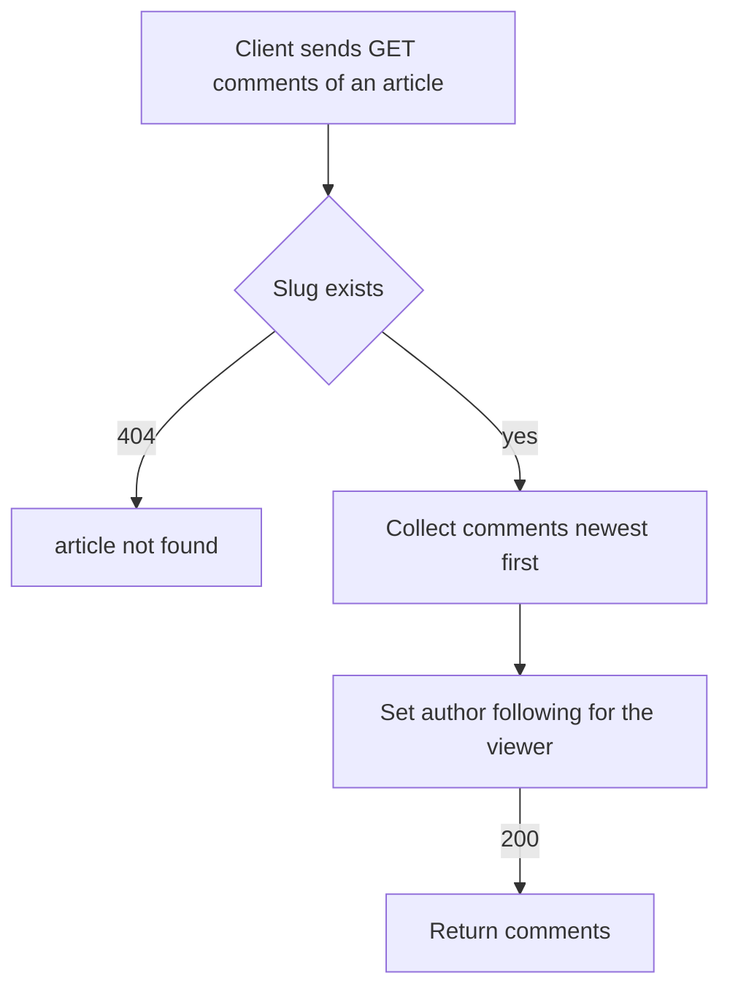

# Comment list
<!-- Read ../../index.md first. After changing this document, add an entry to ../../log.md -->

## Purpose
This document owns listing the comments of an article with GET /api/articles/{slug}/comments and the comment representation that the comment endpoints return. It does not cover writing a comment, which [Comment creation](comment-create.md) owns, or removing one, which [Comment deletion](comment-delete.md) owns.

## Current behavior
### Comment lookup
- The endpoint is optional-auth, as [API transport, authentication, and errors](../transport-and-errors.md) describes.
- If no article has the slug, the server answers 404, as [Article lookup by unknown slug](../articles/article-read.md#article-lookup-by-unknown-slug) describes.
- The server answers 200 with a "comments" list holding every comment of the article, from newest to oldest by creation time.
- If the article has no comments, the list is empty.
- The server applies no paging to the list.

### Comment fields
- A comment holds "id", "createdAt", "updatedAt", "body", and "author".
- The "author" is the comment author's profile, as [Profile representation](../accounts/profile-view.md#profile-representation) describes.
- If the viewer is logged in and follows the comment's author, the author's "following" is true; otherwise it is false.
- The timestamps follow [Timestamp format](../transport-and-errors.md#timestamp-format).

## Flow
The diagram shows how the server answers a comment list request.

The viewer changes only the authors' "following" flags; the comments and their order are the same for every viewer.

## Policies
### Comment representation
A comment holds "id", "createdAt", "updatedAt", "body", and "author" as the author's profile.

### Comment list order
The server lists the comments of an article from newest to oldest by creation time, and answers an empty list for an article without comments.

### Comment author following flag
The author's "following" in each comment is true when the viewer follows that author and false otherwise.

### Comment list paging
The server returns every comment of the article in one response without paging.
[needs confirmation] Should the comment list have a page size limit for articles with many comments?

## Evidence
- `apps/comments/api.py:21-40` — comment list endpoint: optional authentication, 404 lookup, newest first, author following computed for the viewer
- `apps/comments/schemas.py:25-43` — comment representation with the author's profile
- `apps/comments/models.py:6-11` — comment fields and creation time
- `apps/comments/tests.py:46-87` — empty list, order, representation, author following with and without a follow

## Open questions
- [needs confirmation] [Comment list paging](#comment-list-paging) — Should the comment list have a page size limit for articles with many comments?

## Related
- [Comments API overview](overview.md)
- [Comment creation](comment-create.md)
- [Comment deletion](comment-delete.md)
- [Article read and representation](../articles/article-read.md)
- [Profile view](../accounts/profile-view.md)
- [API transport, authentication, and errors](../transport-and-errors.md)
