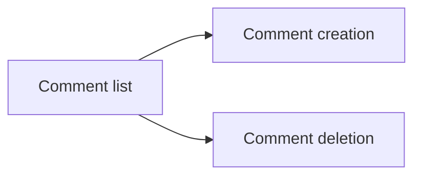

# Comments API
<!-- Read ../../index.md first. After changing this document, add an entry to ../../log.md -->

## Purpose
This area owns the comment endpoints of an article: listing comments, writing a comment, and deleting a comment. It does not cover the article itself, which [Articles API](../articles/overview.md) owns, or the author profile shown inside a comment, which [Profile representation](../accounts/profile-view.md#profile-representation) owns.

## Flow
The diagram shows the order in which a client meets the comment documents.

A client reads an article's comments, then writes a new comment or deletes one it may remove.

## Documents
- [Comment list](comment-list.md) — listing an article's comments and the comment representation
- [Comment creation](comment-create.md) — writing a comment on an article
- [Comment deletion](comment-delete.md) — removing a comment as its author or as the article's author

## Terms
- Comment body(content) — [Comment representation](comment-list.md#comment-representation)

## Related
- [API overview](../overview.md)
- [Spec index](../../index.md)
