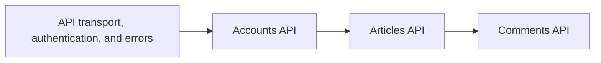

# API
<!-- Read ../index.md first. After changing this document, add an entry to ../log.md -->

## Purpose
This area owns the HTTP API that the server offers to clients under "/api": the shared transport, authentication, and error contracts, and the account, article, and comment endpoints grouped in three subareas. It does not cover how an operator starts and configures the server or the admin tools, which [Operations](../operations/overview.md) owns, or the token router of the third-party jwt_ninja package mounted under "/auth", whose endpoints this repository does not define.

## Flow
The diagram shows how the shared contracts and the three subareas relate in the order a client meets them.

Every endpoint follows the shared contracts; a client gets a token from the accounts endpoints, then reads and writes articles and their comments.

## Documents
- [API transport, authentication, and errors](transport-and-errors.md) — base paths, token header and validation, token issuance, timestamp format, and error body
- [Accounts API](accounts/overview.md) — registration, login, current user, profiles, and follows
- [Articles API](articles/overview.md) — article list and feed, article read, create, update, delete, favorites, and tags
- [Comments API](comments/overview.md) — listing, writing, and deleting comments on an article

## Terms
- Protected endpoint(auth required) — [Protected endpoint without token](transport-and-errors.md#protected-endpoint-without-token)
- Optional-auth endpoint(pass_even) — [Optional authentication without token](transport-and-errors.md#optional-authentication-without-token)

## Related
- [Spec index](../index.md)
- [Operations](../operations/overview.md)
