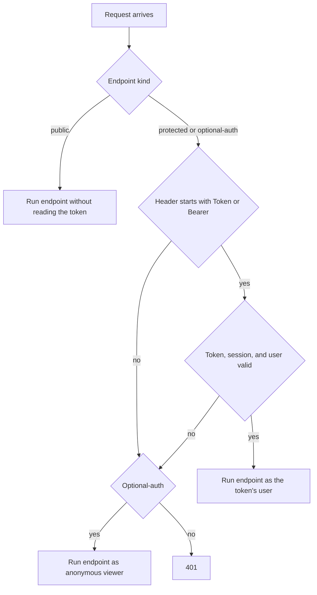

# API transport, authentication, and errors
<!-- Read ../index.md first. After changing this document, add an entry to ../log.md -->

## Purpose
This document owns the contracts that every endpoint shares: the base paths, how a client presents its token, how the server validates a token and issues a new one, the timestamp format, and the error response body. It does not cover the request and response fields of each endpoint; the documents under [Accounts API](accounts/overview.md), [Articles API](articles/overview.md), and [Comments API](comments/overview.md) own those.

## Current behavior
### Base paths
- The server serves the application endpoints under the "/api" prefix.
- The server mounts the token router of the third-party jwt_ninja package under "/auth". This repository does not define the endpoints of that router.
- The server serves the Django admin site under "/admin/", which [Admin site](../operations/admin-site.md) describes.
- The server allows cross-origin requests from every origin.

### Presenting a token
- A client authenticates by sending the Authorization header with the value "Token " followed by the token.
- The server also accepts the prefix "Bearer " in place of "Token ".
- Each endpoint is one of three kinds: a protected endpoint requires a token, an optional-auth endpoint accepts a request with or without a token, and a public endpoint does not read the Authorization header. The table under "Flow" lists the kind of each endpoint.

### Protected endpoints
- If a protected endpoint receives no Authorization header, the server answers 401 and does not run the endpoint.
- If the Authorization header starts with a prefix other than "Token " or "Bearer ", the server answers 401.
- If the token has expired, the server answers 401 with the code "expired_token".
- If the token cannot be decoded or its payload has the wrong format, the server answers 401 with the code "invalid_token".
- If the session that the token names does not exist, the server answers 401 with the code "session_not_found".
- If the session that the token names has an expiry time in the past, the server answers 401 with the code "session_expired".
- If the user that the token names does not exist or is inactive, the server answers 401 with the code "invalid_user".
- If the token passes every check, the server runs the endpoint as the token's user.

### Optional-auth endpoints
- If an optional-auth endpoint receives a valid token, the server runs the endpoint as the token's user.
- If an optional-auth endpoint receives no Authorization header, a header with another prefix, or a token that fails any check, the server runs the endpoint as an anonymous viewer.

### Token issuance
- The server issues a new access token when a client registers, logs in, reads the current user, or updates the current user.
- The token is a JSON Web Token (JWT) made of three dot-separated parts.
- Each issuance creates a new session record for the user, and the token carries the user and the session.
- The session records the IP address "127.0.0.1" for every token that these endpoints issue.
- The settings set the access token lifetime to 7 days and the refresh token lifetime to 7 days.
- The repository code does not end the sessions of earlier tokens when it issues a new one.

### Timestamps
- The server writes the "createdAt" and "updatedAt" values as ISO 8601 UTC timestamps with fractional seconds and a trailing "Z".

### Error response body
- If a request body fails validation, the application error handler answers 422 with `{"errors": {"<field>": ["<message>"]}}`. The handler groups messages by the last element of the error location and removes the prefixes "Value error, " and "Assertion failed, " from each message.
- If a resource is not found, the application error handler answers 404 with `{"errors": {"<resource>": ["not found"]}}`. The resource name is the one the endpoint looked up ("profile", "article", or "comment"); otherwise the handler derives it from the path.
- If a user is not allowed to act on a resource, the application error handler answers 403 with `{"errors": {"<resource>": ["forbidden"]}}`. The handler derives the resource from the path: a path containing "/comments/" gives "comment", then "/profiles/" gives "profile", then "/articles/" gives "article", and any other path gives "resource".
- If an HTTP error with status 401 reaches the application error handler, it answers `{"errors": {"token": ["is missing"]}}`.
- If any other HTTP error reaches the application error handler, it answers `{"detail": "<message>"}` with the error's status.
- The tests call each router directly and observe the library default bodies instead: 401 answers `{"detail": "Unauthorized"}` and 422 answers `{"detail": [...]}` with the type, location, and message of each error.
- Endpoint-specific errors such as 409 "has already been taken" and 401 "credentials invalid" are written by the endpoints themselves and are owned by the endpoint documents.

## Flow
The diagram shows how the server decides who the caller is before it runs an endpoint.

A protected endpoint ends in 401 whenever the token is missing or invalid. An optional-auth endpoint never answers 401 for token reasons and falls back to an anonymous viewer.

| Endpoint | Authentication kind | Owning document |
| --- | --- | --- |
| POST /api/users | public | [User registration](accounts/registration.md) |
| POST /api/users/login | public | [User login](accounts/login.md) |
| GET /api/user | protected | [Current user read and update](accounts/current-user.md) |
| PUT /api/user | protected | [Current user read and update](accounts/current-user.md) |
| GET /api/profiles/{username} | optional-auth | [Profile view](accounts/profile-view.md) |
| POST /api/profiles/{username}/follow | protected | [Profile follow and unfollow](accounts/profile-follow.md) |
| DELETE /api/profiles/{username}/follow | protected | [Profile follow and unfollow](accounts/profile-follow.md) |
| GET /api/articles | public | [Article list and feed](articles/article-list-and-feed.md) |
| GET /api/articles/feed | protected | [Article list and feed](articles/article-list-and-feed.md) |
| GET /api/articles/{slug} | optional-auth | [Article read and representation](articles/article-read.md) |
| POST /api/articles | protected | [Article creation](articles/article-create.md) |
| PUT /api/articles/{slug} | protected | [Article update](articles/article-update.md) |
| DELETE /api/articles/{slug} | protected | [Article deletion](articles/article-delete.md) |
| POST /api/articles/{slug}/favorite | protected | [Article favorite and unfavorite](articles/article-favorite.md) |
| DELETE /api/articles/{slug}/favorite | protected | [Article favorite and unfavorite](articles/article-favorite.md) |
| GET /api/tags | public | [Tag list](articles/tag-list.md) |
| GET /api/articles/{slug}/comments | optional-auth | [Comment list](comments/comment-list.md) |
| POST /api/articles/{slug}/comments | protected | [Comment creation](comments/comment-create.md) |
| DELETE /api/articles/{slug}/comments/{id} | protected | [Comment deletion](comments/comment-delete.md) |

## Policies
### Token header prefix
A client presents its token in the Authorization header as "Token " followed by the token, and the server accepts it on protected endpoints.

### Bearer token prefix
The server accepts the prefix "Bearer " in the Authorization header in the same way as "Token ". It treats any other prefix as a missing token.
[needs confirmation] No test sends a "Bearer " token; is accepting both prefixes the intended contract, and if not, which prefix should the server accept?

### Protected endpoint without token
If a protected endpoint receives no token, the server answers 401 and does not change any data.

### Optional authentication without token
If an optional-auth endpoint receives no token, the server answers as it would for an anonymous viewer, so every viewer-dependent flag is false.

### Optional authentication with invalid token
If an optional-auth endpoint receives a token with an unknown prefix or a token that fails validation, the server ignores it and answers as it would for an anonymous viewer instead of answering 401.
[needs confirmation] No test sends an invalid token to an optional-auth endpoint; is silently falling back to an anonymous viewer intended, or should the server answer 401?

### Token validation failure codes
On a protected endpoint the server answers 401 with the code "expired_token" for an expired token, "invalid_token" for a token it cannot decode, "session_not_found" for an unknown session, "session_expired" for a session whose expiry time has passed, and "invalid_user" for an unknown or inactive user. The codes come from errors raised by the jwt_ninja package, and the response body that carries them depends on the error handling described in [API error response body](#api-error-response-body).
[needs confirmation] No test covers any of these failures; what response body and code should a client receive for each one?

### Issued token format
Every endpoint that returns a user also returns a newly issued token that is a JWT with three dot-separated parts.

### Token session and lifetime
Each token issuance creates a new session record whose IP address is always "127.0.0.1", because the endpoints do not pass the request to the token helper. The settings set the access token lifetime and the refresh token lifetime to 7 days each. The repository code does not end the sessions of earlier tokens when it issues a new one.
[needs confirmation] What is the basis of the 7-day lifetimes, should the session record the client's real IP address, and should a new token end the sessions of earlier tokens?

### Timestamp format
The server writes "createdAt" and "updatedAt" as ISO 8601 UTC timestamps with fractional seconds and a trailing "Z".

### API error response body
The application error handlers answer 422 with `{"errors": {"<field>": ["<message>"]}}`, 404 with `{"errors": {"<resource>": ["not found"]}}`, 403 with `{"errors": {"<resource>": ["forbidden"]}}`, and an HTTP 401 error with `{"errors": {"token": ["is missing"]}}`. The tests call the routers directly and observe the library default bodies `{"detail": "Unauthorized"}` for 401 and `{"detail": [...]}` for 422, and they check only the status codes of 403 and 404.
[needs confirmation] Which body does a client of the running server receive for 401, 403, 404, and 422, and which one is the intended contract?

### Cross-origin access
The server allows cross-origin requests from every origin.
[needs confirmation] Is allowing every origin intended for every environment, or should the allowed origins be restricted?

## Evidence
- `config/urls.py:28-30` — "/api" prefix and the application API instance
- `config/urls.py:33-72` — application error handlers for validation, not found, forbidden, and HTTP errors, and the path-to-resource rule
- `config/urls.py:75-83` — router mounts for accounts, articles, comments, the jwt_ninja router under "/auth", and the admin site
- `config/settings.py:28` — cross-origin requests allowed from every origin
- `config/settings.py:152-155` — access and refresh token lifetimes of 7 days
- `helpers/jwt_utils.py:34-98` — TokenAuth: "Token " and "Bearer " prefixes, pass_even fallback to an anonymous viewer, and token, session, and user checks with their 401 codes
- `helpers/jwt_utils.py:101-113` — create_jwt_token: new session per issuance, default IP address, access payload
- `helpers/exceptions.py:9-19` — ResourceNotFound and get_or_404 carry the resource name into the 404 handler
- `apps/accounts/tests.py:160-190` — protected endpoint with a "Token " header succeeds and without a token answers 401 with the library default body
- `apps/accounts/tests.py:340-344` — optional-auth endpoint without a token answers as an anonymous viewer
- `apps/accounts/tests.py:23-38` — issued token has three dot-separated parts
- `apps/articles/tests.py:70-73` — timestamp format check
- `apps/comments/tests.py:46-49` — timestamp format check
- `apps/accounts/tests.py:92-110` — library default 422 body observed through the router

## Open questions
- [needs confirmation] [Bearer token prefix](#bearer-token-prefix) — No test sends a "Bearer " token; is accepting both prefixes the intended contract, and if not, which prefix should the server accept?
- [needs confirmation] [Optional authentication with invalid token](#optional-authentication-with-invalid-token) — No test sends an invalid token to an optional-auth endpoint; is silently falling back to an anonymous viewer intended, or should the server answer 401?
- [needs confirmation] [Token validation failure codes](#token-validation-failure-codes) — No test covers any of these failures; what response body and code should a client receive for each one?
- [needs confirmation] [Token session and lifetime](#token-session-and-lifetime) — What is the basis of the 7-day lifetimes, should the session record the client's real IP address, and should a new token end the sessions of earlier tokens?
- [needs confirmation] [API error response body](#api-error-response-body) — Which body does a client of the running server receive for 401, 403, 404, and 422, and which one is the intended contract?
- [needs confirmation] [Cross-origin access](#cross-origin-access) — Is allowing every origin intended for every environment, or should the allowed origins be restricted?

## Related
- [API overview](overview.md)
- [Accounts API overview](accounts/overview.md)
- [Articles API overview](articles/overview.md)
- [Comments API overview](comments/overview.md)
- [Server startup configuration](../operations/startup-configuration.md)
- [Admin site](../operations/admin-site.md)
