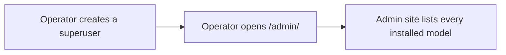

# Admin site
<!-- Read ../index.md first. After changing this document, add an entry to ../log.md -->

## Purpose
This document owns the Django admin site that an operator opens under "/admin/" and the superuser accounts that can use it. It does not cover the command-line user creation in this repository, which [Create user command](create-user-command.md) owns.

## Current behavior
### Admin site address
- The server serves the Django admin site under "/admin/", outside the "/api" prefix.

### Models in the admin site
- The admin site lists every model of every installed application, including users, articles, tags, comments, and the token sessions.
- The accounts and comments applications do not register their own admin pages; the articles application registers all models at once.

### Superuser accounts
- A superuser account is created with the staff, superuser, and active flags set to true.
- If a superuser request sets the staff flag or the superuser flag to anything other than true, the server rejects it with the message "Superuser must be assigned to is_staff=True." or "Superuser must be assigned to is_superuser=True.".
- A superuser account logs in with its email, because the email is the account identifier.

## Flow
The diagram shows the order in which an operator reaches the admin site.

The admin site shows every model without a per-model configuration.

## Policies
### Admin site model registration
The articles application registers every model of every installed application in the admin site with the default admin page, and skips a model that is already registered.
[needs confirmation] Should the admin site expose every model, including users and token sessions, or only a chosen set with their own admin pages?

### Superuser creation flags
The account manager creates a superuser with the staff, superuser, and active flags set to true and rejects a request that sets the staff or superuser flag to anything else.
[needs confirmation] No test creates a superuser; are these flags and error messages the intended contract?

## Evidence
- `config/urls.py:80-83` — admin site under "/admin/"
- `apps/articles/admin.py:1-10` — registration of every installed model
- `apps/accounts/admin.py:1` — no account admin page
- `apps/comments/admin.py:1` — no comment admin page
- `apps/accounts/models.py:17-26` — superuser creation flags and error messages
- `apps/accounts/models.py:41-43` — email as the account identifier

## Open questions
- [needs confirmation] [Admin site model registration](#admin-site-model-registration) — Should the admin site expose every model, including users and token sessions, or only a chosen set with their own admin pages?
- [needs confirmation] [Superuser creation flags](#superuser-creation-flags) — No test creates a superuser; are these flags and error messages the intended contract?

## Related
- [Operations overview](overview.md)
- [Create user command](create-user-command.md)
- [API transport, authentication, and errors](../api/transport-and-errors.md)
