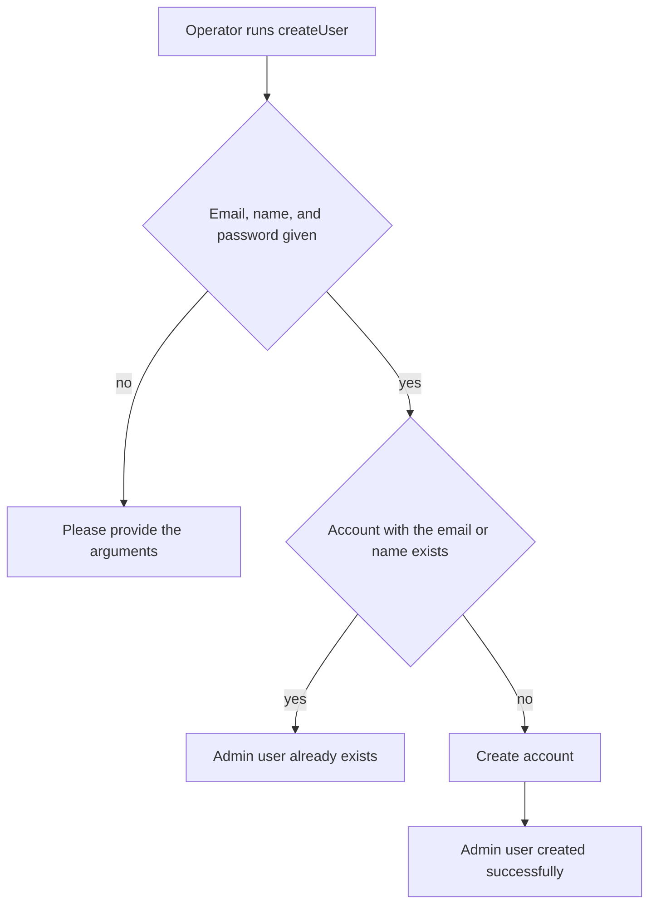

# Create user command
<!-- Read ../index.md first. After changing this document, add an entry to ../log.md -->

## Purpose
This document owns the createUser management command that an operator runs to create an account from the command line, from passing the arguments until the command prints its result. It does not cover account registration through the API, which [User registration](../api/accounts/registration.md) owns.

## Current behavior
### Command arguments
- The operator runs the command with "--email", "--name", and "--password".
- If any of the three arguments is missing or empty, the command prints "Please provide --email, --name, and --password arguments." and creates nothing.

### Existing account check
- The command looks for an account with the given email and for an account whose field "name" equals the given name.
- The user model has no field "name", because the field was renamed to "username".
- If no account matches, the command creates an account with the email, the password, and the name, and prints "Admin user created successfully.".
- If an account matches, the command prints "Admin user already exists." and creates nothing.

### Account role
- The command creates an ordinary account that is neither staff nor superuser, although its messages call it an admin user.

## Flow
The diagram shows the branches of the command as the code writes them.

The lookup and the creation both use the field "name", which the user model no longer has.

## Policies
### Create user command arguments
The command requires "--email", "--name", and "--password", and prints "Please provide --email, --name, and --password arguments." when any of them is missing or empty.
[needs confirmation] No test runs the command; is this message and the requirement for all three arguments the intended contract?

### Create user command field names
The command looks up and creates the account with a field called "name", while the user model calls that field "username" since the field was renamed.
[needs confirmation] Should the command use "username" for the lookup and the creation, and should its argument be renamed to "--username"?

### Create user command account role
The command creates an ordinary account that is neither staff nor superuser, while its messages say "Admin user created successfully." and "Admin user already exists.".
[needs confirmation] Should the command create a staff or superuser account that can use the [Admin site](admin-site.md), or should its messages describe an ordinary account?

## Evidence
- `apps/accounts/management/commands/createUser.py:5-26` — arguments, existing account check by email and name, account creation, printed messages
- `apps/accounts/migrations/0002_rename_name_user_username.py:10-16` — the field "name" renamed to "username"
- `apps/accounts/models.py:7-15` — create_user creates an ordinary account

## Open questions
- [needs confirmation] [Create user command arguments](#create-user-command-arguments) — No test runs the command; is this message and the requirement for all three arguments the intended contract?
- [needs confirmation] [Create user command field names](#create-user-command-field-names) — Should the command use "username" for the lookup and the creation, and should its argument be renamed to "--username"?
- [needs confirmation] [Create user command account role](#create-user-command-account-role) — Should the command create a staff or superuser account that can use the [Admin site](admin-site.md), or should its messages describe an ordinary account?

## Related
- [Operations overview](overview.md)
- [Admin site](admin-site.md)
- [User registration](../api/accounts/registration.md)
