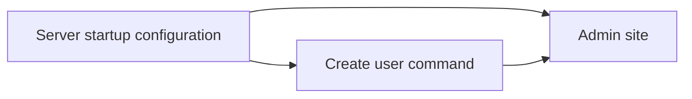

# Operations
<!-- Read ../index.md first. After changing this document, add an entry to ../log.md -->

## Purpose
This area owns what an operator does outside the client API: configuring the server through environment variables at startup, using the Django admin site, and creating accounts with the createUser command. It does not cover the client endpoints, which [API](../api/overview.md) owns.

## Flow
The diagram shows the order in which an operator meets the operations documents.

An operator configures and starts the server first, then creates accounts and manages data in the admin site.

## Documents
- [Server startup configuration](startup-configuration.md) — debug mode, allowed hosts, database selection, and password hasher from environment variables
- [Admin site](admin-site.md) — the Django admin site, its registered models, and superuser accounts
- [Create user command](create-user-command.md) — the createUser management command

## Related
- [Spec index](../index.md)
- [API](../api/overview.md)
