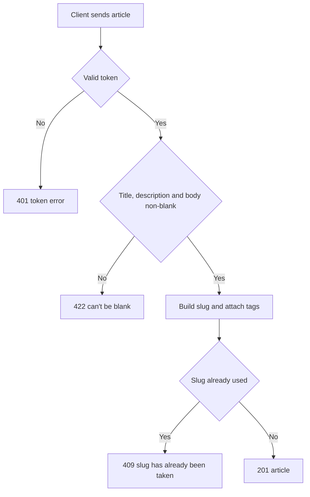

# Article creation
<!-- Read ../../index.md first. After changing this document, add an entry to ../../log.md -->

## Purpose
This document owns POST /api/articles, which publishes a new article by the signed-in user, and the slug and tag rules that article update shares. Changing an article is owned by [Article update](article-update.md). The endpoint requires authentication as described in [Authentication token](../authentication-token.md).

## Current behavior
### Article request
- If the request carries no valid token, the server rejects it with status 401.
- The client sends {"article": {"title", "description", "body", "tagList"}}; tagList is optional.
- The server trims title, description and body and stores the trimmed values.
- If title, description or body is blank after trimming, the server responds with status 422 and "can't be blank" under that field.
- If tagList is absent, the article has no tags.

### Slug generation
- The server builds the slug from the title converted by the slugify library with its default options, followed by "-" and the first 8 characters of a random UUID.
- The slug keeps the letter case of the title.
- If the slug collides with an existing article's slug, the server responds with status 409 and {"errors": {"slug": ["has already been taken"]}}.

### Tags
- For each name in tagList, the server attaches the existing tag with that exact name or creates a new tag.
- The server stores tag names as sent, without trimming.

### Creation response
- The server responds with status 201 and {"article": <article object>} with every field.
- A new article has favorited false and favoritesCount 0.

## Flow
The diagram shows the creation request from validation to the response.

A successful creation always returns the new article with its generated slug.

## Policies
### Article slug generation
Article creation, and article update when the title changes, set the slug to the slugify library's default conversion of the title followed by "-" and the first 8 characters of a random UUID. The slug keeps the title's letter case, and two articles with the same title get different slugs. If a generated slug already exists, the server responds with 409 and slug "has already been taken" instead of generating another. No test covers this rule.
[needs confirmation] What is the basis of the 8-character random suffix, should the slug be lowercase, and should a slug collision be retried rather than rejected?

### Article required fields
Article creation requires title, description and body to be non-blank after trimming and rejects a blank value with 422 "can't be blank". tagList is optional and defaults to no tags. No test covers this rule.
[needs confirmation] Is this the intended set of required article fields?

### Article tag name handling
Article creation and article update attach an existing tag whose name equals a tagList entry exactly or create a new tag. Tag names are not trimmed or lowercased, an empty string is accepted as a tag name, and the server applies no limit on the number of tags. No test covers this rule.
[needs confirmation] Should tag names be trimmed, lowercased or deduplicated, should empty names be rejected, and should the number of tags be limited?

## Evidence
- `server/routes/api/articles/index.post.ts` — validates the request, builds the slug, attaches or creates tags, creates the article and maps a slug collision to 409
- `server/schemas/article.schema.ts` — creation fields, trimming, "can't be blank" and the optional tag list
- `server/utils/article.mapper.ts` — builds the returned article object
- `server/utils/prisma-errors.ts` — converts a slug collision into 409
- `prisma/schema.prisma` — unique article slug and unique tag name

## Open questions
- [needs confirmation] [Article slug generation](#article-slug-generation) — What is the basis of the 8-character random suffix, should the slug be lowercase, and should a slug collision be retried rather than rejected?
- [needs confirmation] [Article required fields](#article-required-fields) — Is this the intended set of required article fields?
- [needs confirmation] [Article tag name handling](#article-tag-name-handling) — Should tag names be trimmed, lowercased or deduplicated, should empty names be rejected, and should the number of tags be limited?

## Related
- [Articles API overview](overview.md)
- [Article update](article-update.md)
- [Article object](../article-object.md)
- [Tag list](tag-list.md)
- [Authentication token](../authentication-token.md)
- [HTTP transport and error responses](../http-transport.md)
