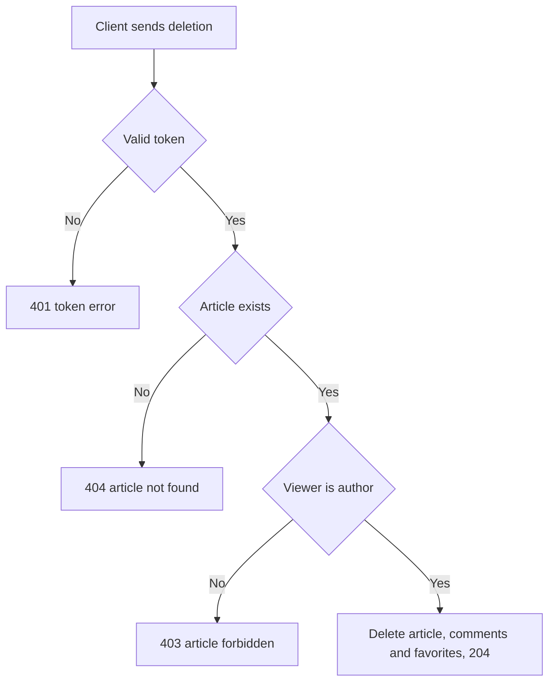

# Article deletion
<!-- Read ../../index.md first. After changing this document, add an entry to ../../log.md -->

## Purpose
This document owns DELETE /api/articles/:slug, which lets the author delete an article together with its comments and favorites. The author-only rule is owned by [Article update](article-update.md#article-modification-by-author-only). The endpoint requires authentication as described in [Authentication token](../authentication-token.md).

## Current behavior
### Deletion checks
- If the request carries no valid token, the server rejects it with status 401.
- If no article has the slug, the server responds with status 404 as described in [Article not found response](article-read.md#article-not-found-response).
- If the signed-in user is not the article's author, the server responds with status 403 and {"errors": {"article": ["forbidden"]}}.

### Deletion result
- The server deletes the article and responds with status 204 and an empty body.
- The article's comments and every user's favorite of it are deleted with it.
- The article's tags stay stored; a tag that no other article uses no longer appears in the [Tag list](tag-list.md).

## Flow
The diagram shows the deletion checks.

Only the author's request deletes the article, and it ends with 204.

## Policies
### Article deletion cascade
Deleting an article also deletes its comments and its favorites, keeps its tags stored, and returns status 204 with an empty body. No test covers this rule.
[needs confirmation] Is removing comments and favorites with the article intended, and should tags that no article uses any more be deleted?

## Evidence
- `server/routes/api/articles/[slug]/index.delete.ts` — checks existence and authorship, deletes the article and returns 204
- `prisma/schema.prisma` — cascading deletion of comments and favorite links with the article

## Open questions
- [needs confirmation] [Article deletion cascade](#article-deletion-cascade) — Is removing comments and favorites with the article intended, and should tags that no article uses any more be deleted?

## Related
- [Articles API overview](overview.md)
- [Article update](article-update.md)
- [Article read](article-read.md)
- [Tag list](tag-list.md)
- [Authentication token](../authentication-token.md)
