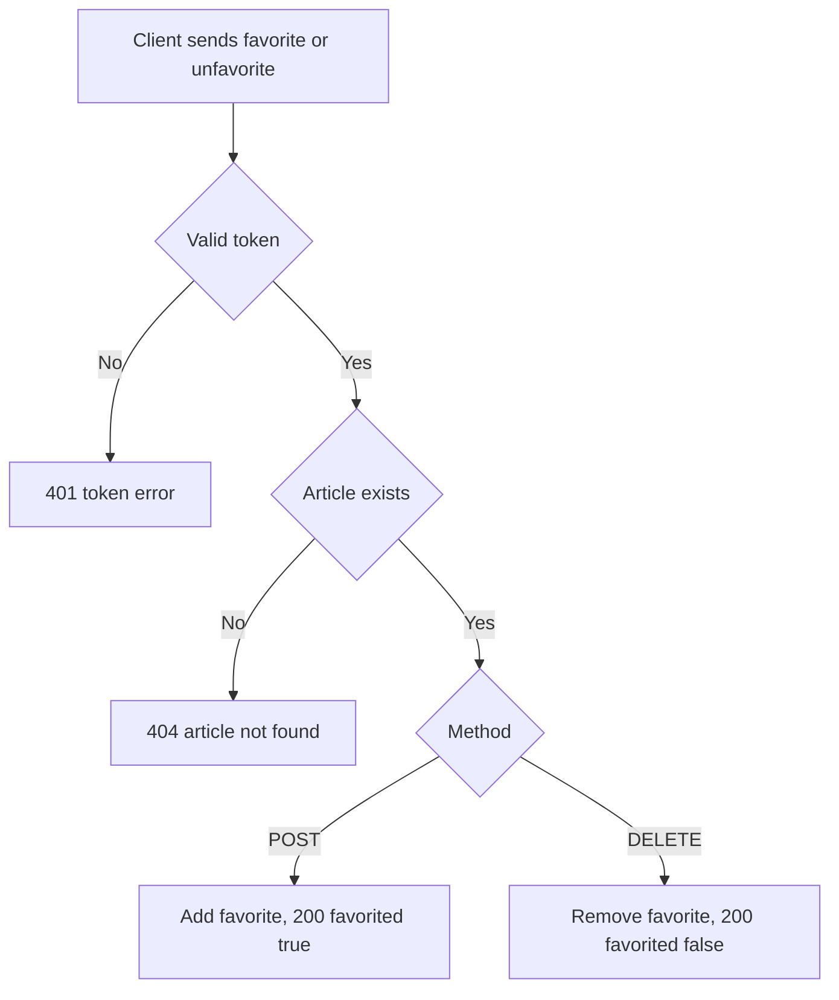

# Article favorite and unfavorite
<!-- Read ../../index.md first. After changing this document, add an entry to ../../log.md -->

## Purpose
This document owns POST /api/articles/:slug/favorite and DELETE /api/articles/:slug/favorite, which add and remove the signed-in user's favorite of an article, and the response object those two endpoints return. The favorited flag and count in other article responses are owned by [Article object](../article-object.md#article-favorited-flag-and-count). Both endpoints require authentication as described in [Authentication token](../authentication-token.md).

## Current behavior
### Favorite checks
- If the request carries no valid token, the server rejects it with status 401.
- If no article has the slug, the server responds with status 404 as described in [Article not found response](article-read.md#article-not-found-response).

### Favorite
- On POST, the server records the signed-in user's favorite of the article.
- If the user has already favorited the article, the server keeps a single favorite and responds as for a first favorite.
- The author can favorite their own article.

### Unfavorite
- On DELETE, the server removes the signed-in user's favorite of the article.
- If the user has not favorited the article, the server changes nothing and responds as for an unfavorite.

### Favorite response
- The server responds with status 200 and {"article": …} with favorited true after a favorite and false after an unfavorite, and favoritesCount after the change.
- The article in this response also contains the internal article id, the author's internal id, and favoritedBy, the full stored record of every user who favorited the article.
- Each favoritedBy record includes that user's email and password hash.

## Flow
The diagram shows the favorite and unfavorite requests.

Repeating a favorite or an unfavorite returns the same result as the first request.

## Policies
### Repeated favorite and unfavorite
Favoriting an article that is already favorited keeps one favorite and returns favorited true, and unfavoriting an article that is not favorited changes nothing and returns favorited false; neither request returns an error. No test covers this rule.
[needs confirmation] Is it intended that repeated favorite and unfavorite requests succeed without an error?

### Favorite response contents
The favorite and unfavorite responses return the article with the internal article id, the author's internal id and favoritedBy, which holds the full stored record, including email and password hash, of every user who favorited the article. The other article endpoints return the [Article object](../article-object.md) without these fields.
[needs confirmation] Is exposing id, authorId and the favoriting users' records, including emails and password hashes, intended, and which fields should these responses contain?

## Evidence
- `server/routes/api/articles/[slug]/favorite/index.post.ts` — checks the article, adds the signed-in user's favorite and returns the article with every stored field
- `server/routes/api/articles/[slug]/favorite/index.delete.ts` — checks the article, removes the signed-in user's favorite and returns the article with every stored field
- `server/utils/profile.utils.ts` — builds the author profile in the response
- `prisma/schema.prisma` — favorite relation between users and articles with one row per pair

## Open questions
- [needs confirmation] [Repeated favorite and unfavorite](#repeated-favorite-and-unfavorite) — Is it intended that repeated favorite and unfavorite requests succeed without an error?
- [needs confirmation] [Favorite response contents](#favorite-response-contents) — Is exposing id, authorId and the favoriting users' records, including emails and password hashes, intended, and which fields should these responses contain?

## Related
- [Articles API overview](overview.md)
- [Article object](../article-object.md)
- [Article read](article-read.md)
- [Article list](article-list.md)
- [Authentication token](../authentication-token.md)
