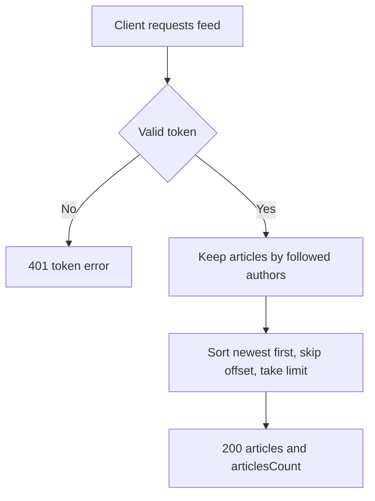

# Article feed
<!-- Read ../../index.md first. After changing this document, add an entry to ../../log.md -->

## Purpose
This document owns GET /api/articles/feed, which lists the articles written by users the signed-in user follows. The general article list is owned by [Article list](article-list.md), and following is owned by [Profile follow and unfollow](../profiles/profile-follow.md). The endpoint requires authentication as described in [Authentication token](../authentication-token.md).

## Current behavior
### Feed selection
- If the request carries no valid token, the server rejects it with status 401.
- The server keeps only articles whose author the signed-in user follows.
- If the signed-in user follows themselves, their own articles are part of the feed.
- If the signed-in user follows nobody, the feed is empty.
- The feed accepts no author, tag or favorited filter.

### Feed order and pagination
- The server sorts the feed newest first and applies limit and offset as described in [Article list pagination](article-list.md#article-list-pagination) and [Article list order](article-list.md#article-list-order).

### Feed response
- The server responds with status 200 and {"articles": [<article object>…], "articlesCount": <number>}.
- articlesCount is the total number of feed articles, as described in [Article count in list responses](article-list.md#article-count-in-list-responses).
- Each article omits body, and tags keep their stored order, as described in [Article representation variants](../article-object.md#article-representation-variants).

## Flow
The diagram shows how the server builds the feed.

A signed-in user who follows nobody receives an empty feed with articlesCount 0.

## Policies
### Feed article selection
The feed contains only articles whose author the signed-in user follows, including the user's own articles when they follow themselves. No test covers this rule.
[needs confirmation] Is the feed meant to contain only followed authors' articles, and should the user's own articles be included?

## Evidence
- `server/routes/api/articles/feed.get.ts` — requires a token, selects articles by followed authors, counts them, sorts newest first and applies limit and offset
- `server/utils/article.mapper.ts` — builds each article object for the viewer

## Open questions
- [needs confirmation] [Feed article selection](#feed-article-selection) — Is the feed meant to contain only followed authors' articles, and should the user's own articles be included?

## Related
- [Articles API overview](overview.md)
- [Article list](article-list.md)
- [Article object](../article-object.md)
- [Profile follow and unfollow](../profiles/profile-follow.md)
- [Authentication token](../authentication-token.md)
