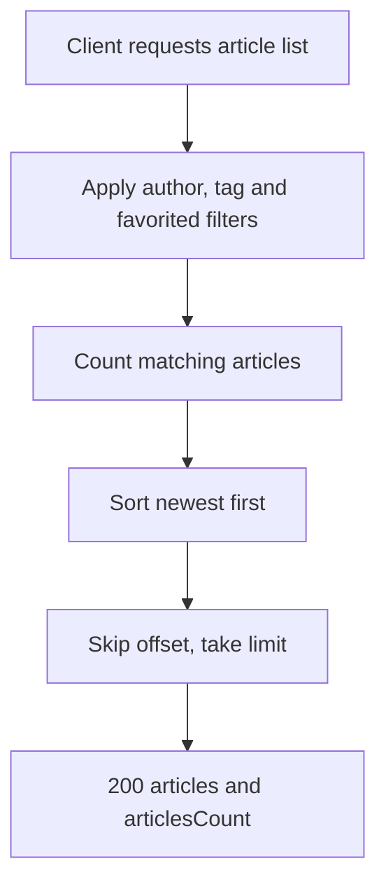

# Article list
<!-- Read ../../index.md first. After changing this document, add an entry to ../../log.md -->

## Purpose
This document owns GET /api/articles, which lists articles newest first with optional filters by author, tag and favoriting user, and the pagination rules that the article feed shares. The articles of followed authors are owned by [Article feed](article-feed.md), and the fields of each article by [Article object](../article-object.md). The endpoint allows anonymous viewers as described in [Authentication token](../authentication-token.md).

## Current behavior
### Filters
- If the query has an author parameter, the server keeps only articles whose author's username equals the value exactly.
- If the query has a tag parameter, the server keeps only articles that carry a tag whose name equals the value exactly.
- If the query has a favorited parameter, the server keeps only articles that the user with that username has favorited.
- If the query has several of these parameters, the server keeps only articles that match all of them.
- If a filter parameter is present with an empty value, the server matches it against an empty name, so the list is empty.
- If the query has none of these parameters, the server lists every article.

### Order and pagination
- The server sorts articles by creation time, newest first.
- The server skips the number of articles in offset and returns at most the number in limit.
- If limit is absent, zero or not a number, the server returns at most 10 articles.
- If offset is absent, zero or not a number, the server starts at the first article.
- The server applies no maximum to limit.

### List response
- The server responds with status 200 and {"articles": [<article object>…], "articlesCount": <number>}.
- articlesCount is the number of articles that match the filters, regardless of limit and offset.
- Each article omits body, and tags are sorted alphabetically, as described in [Article representation variants](../article-object.md#article-representation-variants).
- If the viewer is anonymous, favorited and the author's following are false for every article.

## Flow
The diagram shows how the server builds the list.

The count covers every matching article, while the returned page holds at most limit articles.

## Policies
### Article list filters
The author, tag and favorited query parameters each restrict the list to an exact match on username, tag name or favoriting username, and several parameters combine so that an article must match all of them. A parameter with an empty value matches nothing. No test covers these filters.
[needs confirmation] Is the exact, case-sensitive match on each filter intended, and should an empty filter value be ignored instead of returning an empty list?

### Article list pagination
The article list and the article feed return at most limit articles after skipping offset articles. limit defaults to 10 and offset to 0 when they are absent, zero or not a number, and no maximum applies to limit. A negative value is passed on to the database query unchanged. No test covers this rule.
[needs confirmation] What is the basis of the default page size of 10, should limit have a maximum, and what should a negative limit or offset return?

### Article list order
The article list and the article feed sort articles by creation time, newest first. The order of articles created at the same instant is not defined.
[needs confirmation] Is newest first by creation time the intended order, and what should break ties?

### Article count in list responses
In the article list and the article feed, articlesCount is the total number of articles that match the request, independent of limit and offset.
[needs confirmation] Is articlesCount meant to be the total number of matching articles rather than the number in the returned page?

## Evidence
- `server/routes/api/articles/index.get.ts` — builds the filters, counts matches, sorts newest first, applies limit and offset and returns the list
- `server/utils/article.mapper.ts` — builds each article object for the viewer

## Open questions
- [needs confirmation] [Article list filters](#article-list-filters) — Is the exact, case-sensitive match on each filter intended, and should an empty filter value be ignored instead of returning an empty list?
- [needs confirmation] [Article list pagination](#article-list-pagination) — What is the basis of the default page size of 10, should limit have a maximum, and what should a negative limit or offset return?
- [needs confirmation] [Article list order](#article-list-order) — Is newest first by creation time the intended order, and what should break ties?
- [needs confirmation] [Article count in list responses](#article-count-in-list-responses) — Is articlesCount meant to be the total number of matching articles rather than the number in the returned page?

## Related
- [Articles API overview](overview.md)
- [Article feed](article-feed.md)
- [Article object](../article-object.md)
- [Article favorite and unfavorite](article-favorite.md)
- [Authentication token](../authentication-token.md)
