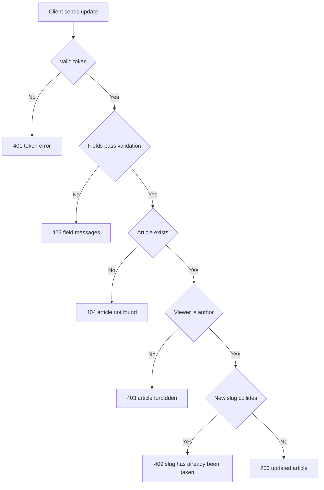

# Article update
<!-- Read ../../index.md first. After changing this document, add an entry to ../../log.md -->

## Purpose
This document owns PUT /api/articles/:slug, which lets the author change an article's title, description, body or tags, and the author-only rule that article deletion shares. Publishing is owned by [Article creation](article-create.md), and deletion by [Article deletion](article-delete.md). The endpoint requires authentication as described in [Authentication token](../authentication-token.md).

## Current behavior
### Request checks
- If the request carries no valid token, the server rejects it with status 401.
- The client sends {"article": {…}} with any subset of title, description, body and tagList.
- If title, description or body is present but blank after trimming, the server responds with status 422 under that field with the validation library's default minimum-length message, not "can't be blank".
- The server validates the body before it looks the article up.
- If no article has the slug, the server responds with status 404 as described in [Article not found response](article-read.md#article-not-found-response).
- If the signed-in user is not the article's author, the server responds with status 403 and {"errors": {"article": ["forbidden"]}}.

### Field changes
- The server stores each present title, description and body trimmed and keeps every absent field.
- If title is present, the server generates a new slug as described in [Article slug generation](article-create.md#article-slug-generation), even when the title is unchanged.
- If tagList is present, the server replaces all of the article's tags with the listed tags, and an empty list removes every tag.
- If tagList is absent, the article keeps its tags.
- The server sets updatedAt to the current time on every successful update, even when the request changes no field.
- The tag replacement and the field changes are applied together, so a failed update leaves the article unchanged.

### Update response
- The server responds with status 200 and {"article": <article object>} with every field and the new slug.
- If the new slug collides with an existing slug, the server responds with status 409 and {"errors": {"slug": ["has already been taken"]}}.

## Flow
The diagram shows the order of the update checks.

A request that fails validation receives 422 before the server checks that the article exists or that the viewer is its author.

## Policies
### Article modification by author only
Only the article's author can update or delete it; any other signed-in user receives status 403 with {"errors": {"article": ["forbidden"]}}. The server checks authentication first, then the update body, then that the article exists, then authorship. No test covers this rule.
[needs confirmation] Is author-only modification the intended permission, and is the check order of 401, 422, 404, then 403 intended?

### Article title change regenerates the slug
When an update contains a title, the server always generates a new slug with a new random suffix, even if the title is unchanged, so the article's previous URL no longer finds it. No test covers this rule.
[needs confirmation] Should the slug change when the title is resent unchanged, and should the old slug keep working?

### Article tag list replacement
When an update contains tagList, the article's tags become exactly the listed tags, and an empty list removes every tag; when tagList is absent, the tags stay as they are. No test covers this rule.
[needs confirmation] Is full replacement of the tag list the intended update behavior?

### Article update timestamp and blank fields
Every successful update sets updatedAt to the current time, including an update with no fields. A blank title, description or body is rejected with the validation library's default minimum-length message, while article creation uses "can't be blank".
[needs confirmation] Should an update without changes still change updatedAt, and should blank fields on update report "can't be blank" like creation?

## Evidence
- `server/routes/api/articles/[slug]/index.put.ts` — validates the update, checks existence and authorship, regenerates the slug on a title change, replaces tags in one transaction and maps a slug collision to 409
- `server/schemas/article.schema.ts` — update fields with trimming and a minimum length of 1 without a custom message
- `server/utils/article.mapper.ts` — builds the returned article object
- `server/utils/prisma-errors.ts` — converts a slug collision into 409

## Open questions
- [needs confirmation] [Article modification by author only](#article-modification-by-author-only) — Is author-only modification the intended permission, and is the check order of 401, 422, 404, then 403 intended?
- [needs confirmation] [Article title change regenerates the slug](#article-title-change-regenerates-the-slug) — Should the slug change when the title is resent unchanged, and should the old slug keep working?
- [needs confirmation] [Article tag list replacement](#article-tag-list-replacement) — Is full replacement of the tag list the intended update behavior?
- [needs confirmation] [Article update timestamp and blank fields](#article-update-timestamp-and-blank-fields) — Should an update without changes still change updatedAt, and should blank fields on update report "can't be blank" like creation?

## Related
- [Articles API overview](overview.md)
- [Article creation](article-create.md)
- [Article read](article-read.md)
- [Article deletion](article-delete.md)
- [Article object](../article-object.md)
- [Tag list](tag-list.md)
- [Authentication token](../authentication-token.md)
- [HTTP transport and error responses](../http-transport.md)
