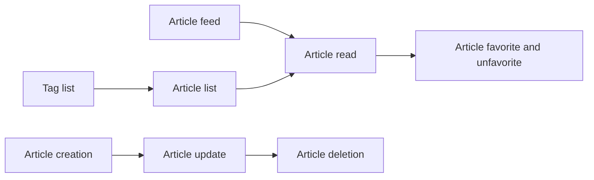

# Articles API
<!-- Read ../../index.md first. After changing this document, add an entry to ../../log.md -->

## Purpose
This area owns the article endpoints: listing articles and the feed, reading, publishing, updating and deleting an article, favoriting it, and the list of popular tags. The fields of each returned article are owned by [Article object](../article-object.md), and comments on an article by the [Comments API](../comments/overview.md).

## Flow
The diagram shows the order in which a user meets the article endpoints.

Readers reach an article through the tag list, the article list or the feed, while authors publish, update and delete their own articles.

## Documents
- [Article list](article-list.md) — GET /api/articles, filters by author, tag and favoriting user, and the pagination, order and count rules shared with the feed
- [Article feed](article-feed.md) — GET /api/articles/feed, articles by authors the signed-in user follows
- [Article read](article-read.md) — GET /api/articles/:slug, one article and the article not found response
- [Article creation](article-create.md) — POST /api/articles, publishing an article and the slug and tag rules
- [Article update](article-update.md) — PUT /api/articles/:slug, author-only changes to fields and tags
- [Article deletion](article-delete.md) — DELETE /api/articles/:slug, author-only deletion with comments and favorites
- [Article favorite and unfavorite](article-favorite.md) — POST and DELETE /api/articles/:slug/favorite and their response object
- [Tag list](tag-list.md) — GET /api/tags, the 10 most used tags

## Terms
- Slug(article identifier, :slug) — [Article slug generation](article-create.md#article-slug-generation)

## Related
- [API overview](../overview.md)
- [Spec index](../../index.md)
