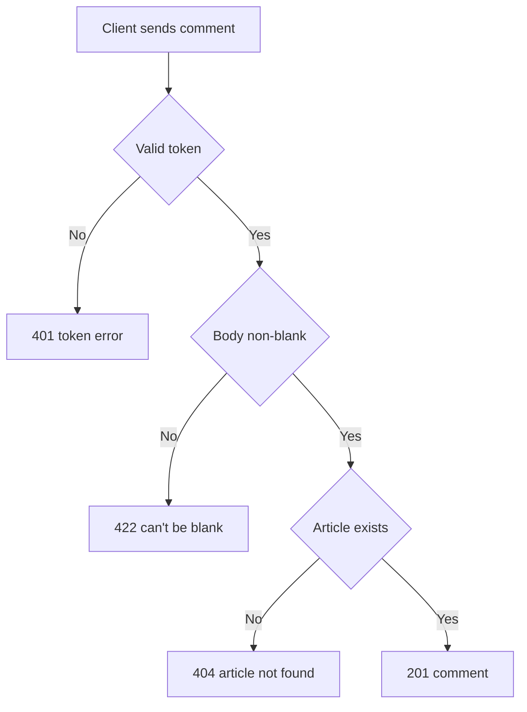

# Comment creation
<!-- Read ../../index.md first. After changing this document, add an entry to ../../log.md -->

## Purpose
This document owns POST /api/articles/:slug/comments, which adds a comment by the signed-in user to an article. The comment object is owned by [Comment list](comment-list.md). The endpoint requires authentication as described in [Authentication token](../authentication-token.md).

## Current behavior
### Comment request
- If the request carries no valid token, the server rejects it with status 401.
- The client sends {"comment": {"body"}}.
- The server trims the body and stores the trimmed value.
- If the body is blank after trimming, the server responds with status 422 and "can't be blank" under body.
- The server validates the body before it looks the article up.
- If no article has the slug, the server responds with status 404 as described in [Article not found response](../articles/article-read.md#article-not-found-response).

### Comment response
- The server responds with status 201 and {"comment": <comment object>}.
- Any signed-in user can comment on any article, including their own.

## Flow
The diagram shows the comment creation checks.

A request with a blank body receives 422 before the server checks the article.

## Policies
### Comment body requirement
A comment requires a body that is non-blank after trimming, and a blank body is rejected with 422 "can't be blank"; the server applies no maximum length. No test covers this rule.
[needs confirmation] Is a non-blank body the only requirement for a comment, and should the body have a maximum length?

## Evidence
- `server/routes/api/articles/[slug]/comments/index.post.ts` — validates the comment, finds the article, creates the comment and returns 201
- `server/schemas/comment.schema.ts` — comment body trimming and the "can't be blank" rule

## Open questions
- [needs confirmation] [Comment body requirement](#comment-body-requirement) — Is a non-blank body the only requirement for a comment, and should the body have a maximum length?

## Related
- [Comments API overview](overview.md)
- [Comment list](comment-list.md)
- [Comment deletion](comment-delete.md)
- [Article read](../articles/article-read.md)
- [Authentication token](../authentication-token.md)
- [HTTP transport and error responses](../http-transport.md)
