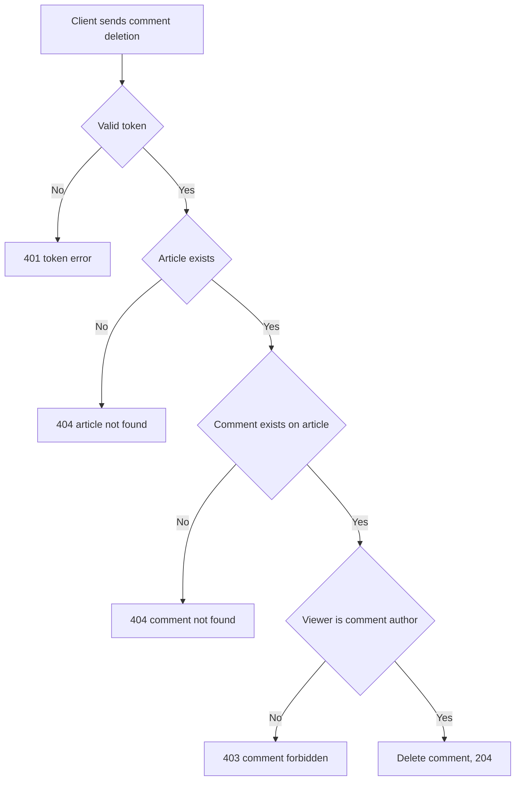

# Comment deletion
<!-- Read ../../index.md first. After changing this document, add an entry to ../../log.md -->

## Purpose
This document owns DELETE /api/articles/:slug/comments/:id, which lets a comment's author delete it. The endpoint requires authentication as described in [Authentication token](../authentication-token.md).

## Current behavior
### Deletion checks
- If the request carries no valid token, the server rejects it with status 401.
- If no article has the slug, the server responds with status 404 as described in [Article not found response](../articles/article-read.md#article-not-found-response).
- If the article has no comment with the id, the server responds with status 404 and {"errors": {"comment": ["not found"]}}.
- A comment that belongs to a different article counts as not found.
- If the signed-in user is not the comment's author, the server responds with status 403 and {"errors": {"comment": ["forbidden"]}}.
- The article's author cannot delete other users' comments on their article.
- If the id is not a number, the server converts it to an invalid number and passes it to the comment lookup; the endpoint defines no response of its own for this case, so any failure falls to [Unhandled server error response](../http-transport.md#unhandled-server-error-response).

### Deletion result
- The server deletes the comment and responds with status 204 and an empty body.

## Flow
The diagram shows the comment deletion checks.

Only the comment's author can delete it, and a successful deletion ends with 204.

## Policies
### Comment deletion by comment author only
Only the comment's author can delete a comment; every other signed-in user, including the article's author, receives 403 with {"errors": {"comment": ["forbidden"]}}. A comment id that does not exist on the addressed article returns 404 with {"errors": {"comment": ["not found"]}}. No test covers this rule.
[needs confirmation] Should the article's author also be able to delete comments on their article, and what should a non-numeric comment id return?

## Evidence
- `server/routes/api/articles/[slug]/comments/[id].delete.ts` — finds the article and the comment on it, checks the comment author and deletes the comment with 204

## Open questions
- [needs confirmation] [Comment deletion by comment author only](#comment-deletion-by-comment-author-only) — Should the article's author also be able to delete comments on their article, and what should a non-numeric comment id return?

## Related
- [Comments API overview](overview.md)
- [Comment list](comment-list.md)
- [Comment creation](comment-create.md)
- [Article read](../articles/article-read.md)
- [Authentication token](../authentication-token.md)
