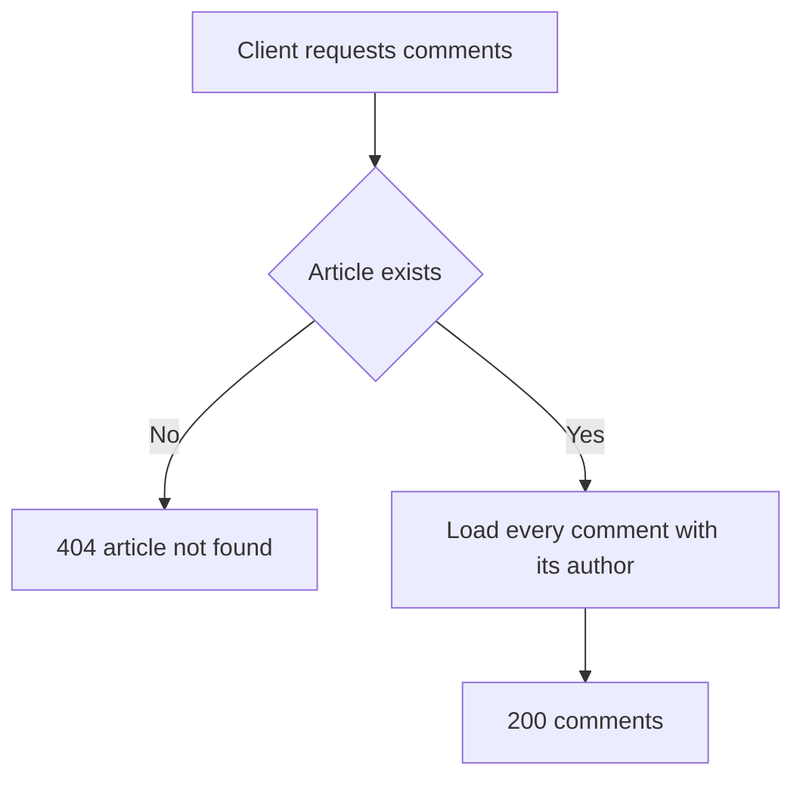

# Comment list
<!-- Read ../../index.md first. After changing this document, add an entry to ../../log.md -->

## Purpose
This document owns GET /api/articles/:slug/comments, which returns every comment on an article, and the comment object that comment creation also returns. Writing a comment is owned by [Comment creation](comment-create.md). The endpoint allows anonymous viewers as described in [Authentication token](../authentication-token.md).

## Current behavior
### Comment lookup
- If no article has the slug, the server responds with status 404 as described in [Article not found response](../articles/article-read.md#article-not-found-response).
- The server returns every comment on the article in one response, without pagination.
- The server applies no explicit sort, so comments come back in the database's default order.

### Comment object
- The server responds with status 200 and {"comments": [<comment object>…]}.
- A comment object contains id, createdAt, updatedAt, body and author.
- author is the comment author's [Profile object](../profile-object.md).
- If the viewer is anonymous, the author's following is false.

## Flow
The diagram shows how the server answers a comment list request.

The request ends in 404 for an unknown slug, or in 200 with every comment on the article.

## Policies
### Comment list order and pagination
The comment list returns all comments on the article in one response, in the database's default order, because the server applies neither pagination nor an explicit sort. No test covers this rule.
[needs confirmation] In what order should comments be returned, and should the comment list be paginated?

## Evidence
- `server/routes/api/articles/[slug]/comments/index.get.ts` — finds the article, loads all its comments with their authors and builds each comment object for the viewer
- `server/models/comment.model.ts` — comment fields

## Open questions
- [needs confirmation] [Comment list order and pagination](#comment-list-order-and-pagination) — In what order should comments be returned, and should the comment list be paginated?

## Related
- [Comments API overview](overview.md)
- [Comment creation](comment-create.md)
- [Comment deletion](comment-delete.md)
- [Profile object](../profile-object.md)
- [Article read](../articles/article-read.md)
- [Authentication token](../authentication-token.md)
