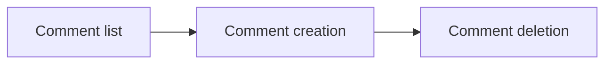

# Comments API
<!-- Read ../../index.md first. After changing this document, add an entry to ../../log.md -->

## Purpose
This area owns the comment endpoints of an article: listing its comments, adding a comment and deleting one's own comment. The article itself is owned by the [Articles API](../articles/overview.md), and the comment author's fields by [Profile object](../profile-object.md).

## Flow
The diagram shows the order in which a user meets the comment endpoints.

A user reads the comments, adds one and can later delete their own.

## Documents
- [Comment list](comment-list.md) — GET /api/articles/:slug/comments, every comment on an article and the comment object
- [Comment creation](comment-create.md) — POST /api/articles/:slug/comments, adding a comment by the signed-in user
- [Comment deletion](comment-delete.md) — DELETE /api/articles/:slug/comments/:id, deletion by the comment's author

## Related
- [API overview](../overview.md)
- [Spec index](../../index.md)
