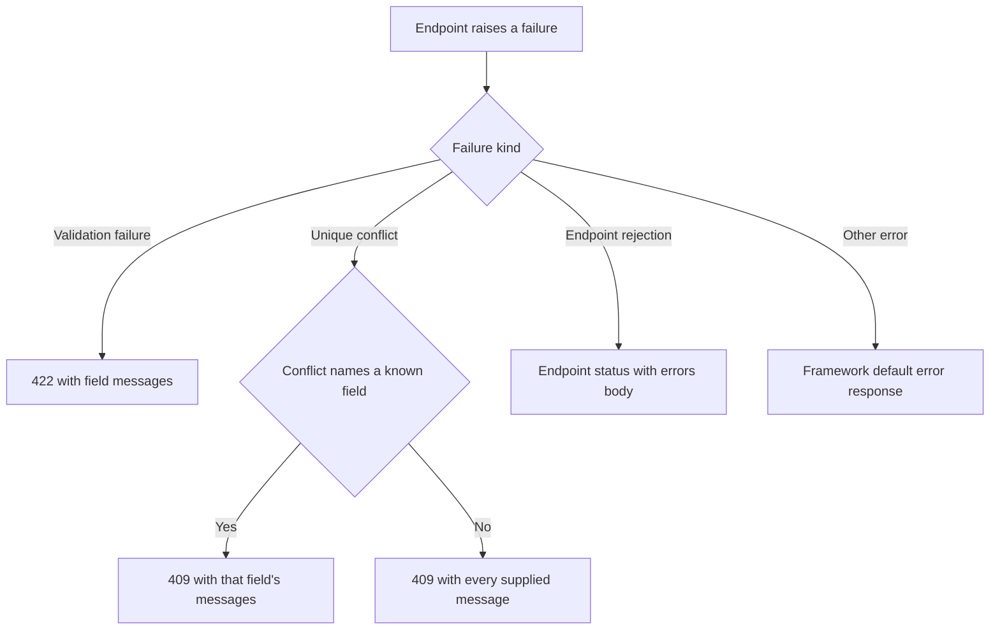

# HTTP transport and error responses
<!-- Read ../index.md first. After changing this document, add an entry to ../log.md -->

## Purpose
This document owns the transport contracts that every endpoint under /api shares: cross-origin (CORS) headers, preflight OPTIONS responses, the JSON error body, request body validation errors, unique-conflict errors and the response to unexpected failures. How a request is authenticated is owned by [Authentication token](authentication-token.md), and each endpoint document owns its own success responses and endpoint-specific errors.

## Current behavior
### Cross-origin requests
- For every path under /api, the server applies the framework's CORS route rule and sends the header access-control-allow-methods with the value "*".
- When a client sends an OPTIONS request to any path under /api, the server responds with status 200 and an empty body.

### Error response body
- When an endpoint rejects a request on purpose, the server responds with that status code, the content-type "application/json" and a JSON body of the form {"errors": {"<field>": ["<message>"]}}.
- The field key names the part of the request that failed (for example "email", "token", "article" or "credentials"), and each message is a short phrase such as "can't be blank" or "not found".
- When a failure carries no such error body (an unexpected exception, a database error that is not a unique conflict, a missing signing secret or an unknown route), the server leaves the response to the framework's default error handling.

### Request body validation
- When an endpoint reads a JSON body, the server validates it against that endpoint's schema before it touches the database.
- Required text fields are trimmed of surrounding whitespace before the length check, and the trimmed value is the one the server stores.
- If validation fails, the server responds with status 422 and one entry per failing field.
- The key of each entry is the last segment of the failing field's path (for example "title" for article.title, or "article" when the whole article object is missing).
- If a failing check has no path, the key is "body".
- If one field fails several checks, the server lists every message under the same key.
- The message is the one the endpoint's schema defines (for example "can't be blank"), or the validation library's default message (for example "Required" for a missing field) when the schema defines none.

### Unique conflicts
- When a create or update collides with a unique value that is already stored (email, username or article slug), the server responds with status 409.
- The body contains only the endpoint's messages for the fields named in the conflict.
- If the conflict names no field, or names a field the endpoint has no message for, the body contains every message the endpoint supplied for that request.
- Database errors other than a unique conflict are not converted and fall to the default error handling.

## Flow
The diagram shows how the server turns a failure into a response.

Validation failures, unique conflicts and endpoint rejections all produce the same {"errors": …} body shape. Any other failure ends in the framework's default error response.

## Policies
### Unique conflict field selection
When a database write fails on a unique constraint, the server responds with status 409 and an errors body that contains only the messages for the fields that the conflict names. If the conflict names none of the fields the endpoint supplied messages for, or names no field at all, the body contains every supplied message.

### Non-unique database errors pass through
When a database write fails for any reason other than a unique constraint (for example a foreign key failure) or fails with an error that is not a database error, the server does not convert it into a 409 response and passes the original error on.

### API CORS policy
The server enables the framework's CORS rule for every path under /api, sends access-control-allow-methods "*" and answers every OPTIONS request under /api with status 200 and an empty body. A configuration comment states that wide-open CORS is acceptable because authentication uses a header token and no cookies.
[needs confirmation] Is wide-open CORS the intended policy for the deployed API, and if not, which origins, methods and headers should be allowed?

### JSON error body format
When an endpoint rejects a request on purpose, the server sends that status code with content-type "application/json" and a body of the form {"errors": {"<field>": ["<message>"]}}. No test covers the conversion of a rejection into this response.
[needs confirmation] Is {"errors": {"<field>": ["<message>"]}} the required error body for every rejection, including authentication errors?

### Request body validation error mapping
When a request body fails its schema, the server responds with status 422 and groups the messages by the last segment of each failing field's path. A failure with no path uses the key "body". Several failures on the same field are listed together under one key. Messages come from the endpoint schema or, when the schema defines none, from the validation library's defaults such as "Required". No test covers this mapping.
[needs confirmation] Is 422 with messages keyed by the last path segment the intended validation contract, and should missing fields report "can't be blank" instead of the library's default message?

### Unhandled server error response
When a failure is neither an endpoint rejection nor a validation or unique-conflict error, the server does not write a response itself and the framework's default error handling produces it. This applies to unknown routes, database errors other than unique conflicts, a missing signing secret, and requests whose token belongs to a user that no longer exists.
[needs confirmation] What status and body should clients receive for unexpected server failures and unknown routes?

## Evidence
- `server/error-handler.ts` — converts endpoint rejections and errors that carry a status and data into JSON responses and leaves every other error to the framework
- `nitro.config.ts` — registers the error handler and the CORS route rule for /api
- `server/routes/api/[...].options.ts` — answers OPTIONS requests under /api with status 200 and an empty body
- `server/models/http-exception.model.ts` — endpoint rejection carrying a status code and an errors body
- `server/utils/validate.ts` — validates a body against a schema and builds the 422 errors body
- `server/utils/prisma-errors.ts` — converts a unique-constraint failure into a 409 errors body
- `server/utils/prisma-errors.test.ts` — tests that a unique conflict yields 409 with the matched field, or every field when none matches or the target is missing, and that other errors are left alone

## Open questions
- [needs confirmation] [API CORS policy](#api-cors-policy) — Is wide-open CORS the intended policy for the deployed API, and if not, which origins, methods and headers should be allowed?
- [needs confirmation] [JSON error body format](#json-error-body-format) — Is {"errors": {"<field>": ["<message>"]}} the required error body for every rejection, including authentication errors?
- [needs confirmation] [Request body validation error mapping](#request-body-validation-error-mapping) — Is 422 with messages keyed by the last path segment the intended validation contract, and should missing fields report "can't be blank" instead of the library's default message?
- [needs confirmation] [Unhandled server error response](#unhandled-server-error-response) — What status and body should clients receive for unexpected server failures and unknown routes?

## Related
- [API overview](overview.md)
- [Authentication token](authentication-token.md)
- [User registration](users/registration.md)
- [Current user read](users/current-user.md)
- [Current user update](users/current-user-update.md)
- [Article creation](articles/article-create.md)
- [Article update](articles/article-update.md)
- [Comment creation](comments/comment-create.md)
- [Comment deletion](comments/comment-delete.md)
