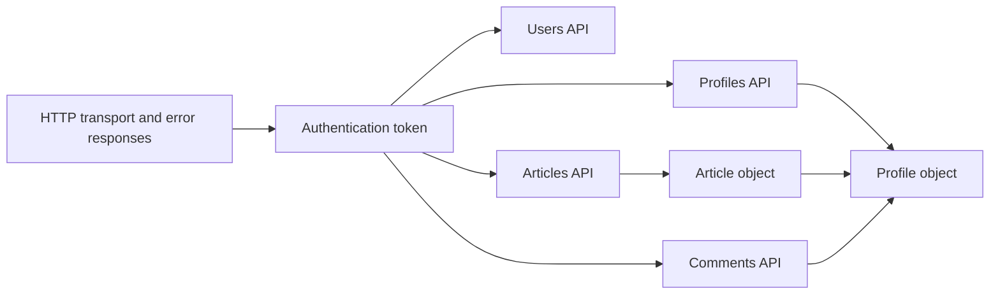

# API
<!-- Read ../index.md first. After changing this document, add an entry to ../log.md -->

## Purpose
This area owns the HTTP JSON API that the server exposes under /api: the transport and authentication contracts that every endpoint shares, the profile and article objects that several endpoints return, and the endpoints grouped by resource into users, profiles, articles and comments. It does not cover building, running or deploying the server, or the database setup.

## Flow
The diagram shows how a request passes through the shared contracts to the resource endpoints.

Every request passes the transport and authentication contracts first, and the profile and article objects are shared by the resource endpoints that return them.

## Documents
- [HTTP transport and error responses](http-transport.md) — CORS, preflight, the JSON error body, validation errors, unique conflicts and unexpected failures
- [Authentication token](authentication-token.md) — token issuance, Authorization header schemes, required and optional authentication and token rejection
- [Profile object](profile-object.md) — profile fields and the viewer-dependent following flag
- [Article object](article-object.md) — article fields, the favorited flag and count, and field differences between endpoints
- [Users API](users/overview.md) — registration, login and the signed-in user's own account
- [Profiles API](profiles/overview.md) — public profiles and following
- [Articles API](articles/overview.md) — article lists, the feed, publishing, changes, favorites and tags
- [Comments API](comments/overview.md) — comments on an article

## Terms
- Authentication token(JWT, Token header, Bearer token) — [Accepted Authorization header schemes](authentication-token.md#accepted-authorization-header-schemes)

## Related
- [Spec index](../index.md)
