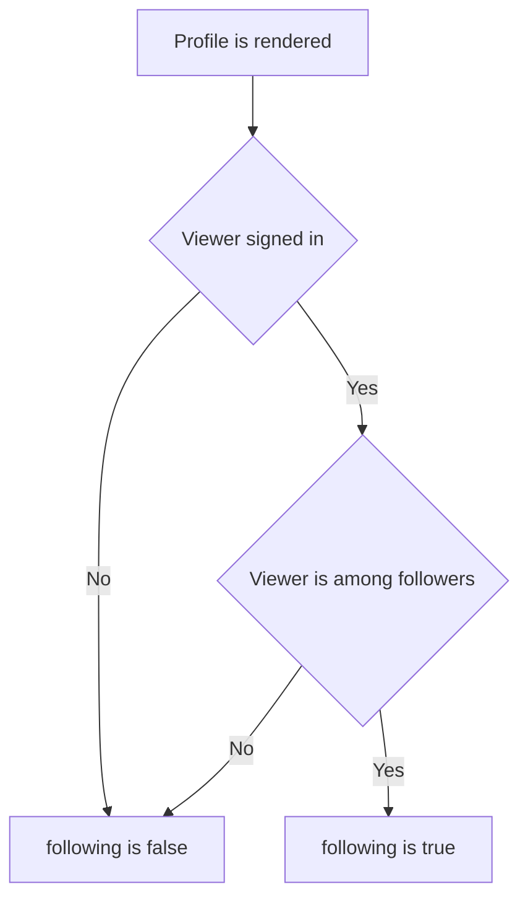

# Profile object
<!-- Read ../index.md first. After changing this document, add an entry to ../log.md -->

## Purpose
This document owns the profile object that the API returns for a user seen by another viewer: its fields and how the following flag depends on the viewer. The profile lookup, follow, unfollow, article and comment endpoints embed it; their documents own when they return it. The account object returned to the signed-in user is owned by the [users API](users/overview.md).

## Current behavior
### Profile fields
- A profile object contains username, bio, image and following.
- If the user has no bio or no image, the field is null.

### Following flag
- If the viewer is signed in and is one of the user's followers, following is true.
- If the viewer is signed in and does not follow the user, following is false.
- If the viewer is anonymous, following is false.
- If the viewer follows themselves, their own profile shows following as true.

### Author profile inside articles
- Every article response embeds the article author as a profile object in the author field.
- In article list and feed responses, the author object omits the bio field; the variants are owned by [Article object](article-object.md#article-representation-variants).

## Flow
The diagram shows how the following flag is decided.

Only a signed-in viewer who follows the user sees following as true.

## Policies
### Profile following flag
A profile object's following field is true only when the signed-in viewer is one of the user's followers; it is false for every anonymous viewer. A user who follows themselves sees following as true on their own profile. No test covers this flag.
[needs confirmation] Is following computed from the viewer's own follow relation the intended contract, and what should a user's own profile report in following?

## Evidence
- `server/utils/profile.utils.ts` — builds the profile object and computes following from the user's followers and the viewer id
- `server/utils/author.mapper.ts` — builds the author profile embedded in articles with the same following rule
- `server/routes/api/articles/[slug]/comments/index.get.ts` — builds the comment author profile with the same following rule
- `prisma/schema.prisma` — stores bio and image as optional values and followers as a self relation on users

## Open questions
- [needs confirmation] [Profile following flag](#profile-following-flag) — Is following computed from the viewer's own follow relation the intended contract, and what should a user's own profile report in following?

## Related
- [API overview](overview.md)
- [Article object](article-object.md)
- [Profile lookup](profiles/profile-lookup.md)
- [Profile follow and unfollow](profiles/profile-follow.md)
- [Comment list](comments/comment-list.md)
