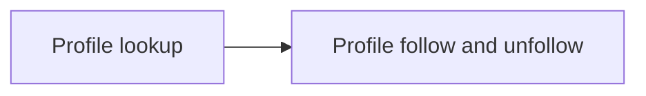

# Profiles API
<!-- Read ../../index.md first. After changing this document, add an entry to ../../log.md -->

## Purpose
This area owns the endpoints for other users' public profiles: looking a profile up by username and following or unfollowing it. The profile fields are owned by [Profile object](../profile-object.md), and the signed-in user's own account by the [Users API](../users/overview.md).

## Flow
The diagram shows the order in which a viewer meets the profile endpoints.

A viewer looks a profile up and then follows or unfollows it.

## Documents
- [Profile lookup](profile-lookup.md) — GET /api/profiles/:username, a public profile for any viewer and the profile not found response
- [Profile follow and unfollow](profile-follow.md) — POST and DELETE /api/profiles/:username/follow, adding and removing the signed-in user as a follower

## Related
- [API overview](../overview.md)
- [Spec index](../../index.md)
