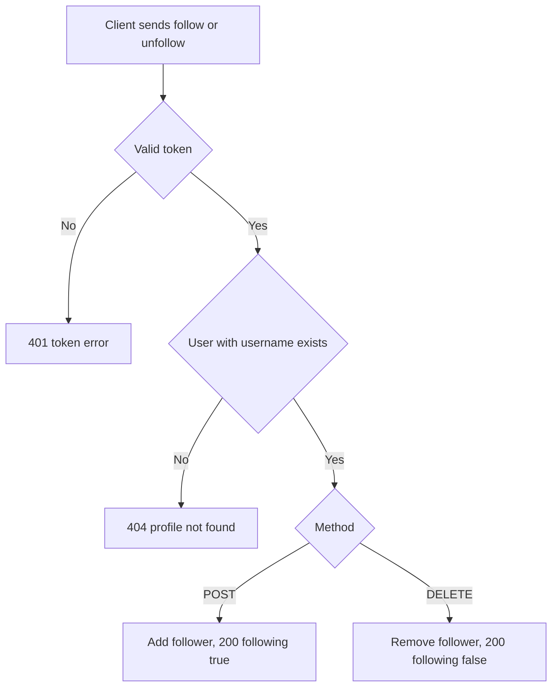

# Profile follow and unfollow
<!-- Read ../../index.md first. After changing this document, add an entry to ../../log.md -->

## Purpose
This document owns POST /api/profiles/:username/follow and DELETE /api/profiles/:username/follow, which add and remove the signed-in user as a follower of another user. Viewing a profile is owned by [Profile lookup](profile-lookup.md), and the articles of followed users are listed by [Article feed](../articles/article-feed.md). Both endpoints require authentication as described in [Authentication token](../authentication-token.md).

## Current behavior
### Target lookup
- If the request carries no valid token, the server rejects it with status 401.
- If no user has the username, the server responds with status 404 as described in [Profile not found response](profile-lookup.md#profile-not-found-response).

### Follow
- On POST, the server records the signed-in user as a follower of the target user.
- If the signed-in user already follows the target, the server keeps a single follow relation and responds as for a first follow.
- The server responds with status 200 and {"profile": <profile object>} with following true.

### Unfollow
- On DELETE, the server removes the signed-in user from the target user's followers.
- If the signed-in user does not follow the target, the server changes nothing and responds as for an unfollow.
- The server responds with status 200 and {"profile": <profile object>} with following false.

### Following oneself
- If the target username is the signed-in user's own username, the server records or removes the self-follow in the same way as for another user.

## Flow
The diagram shows the follow and unfollow requests.

Repeating a follow or an unfollow returns the same result as the first request.

## Policies
### Repeated follow and unfollow
Following a user who is already followed keeps one follow relation and returns following true, and unfollowing a user who is not followed changes nothing and returns following false; neither request returns an error. No test covers this rule.
[needs confirmation] Is it intended that repeated follow and unfollow requests succeed without an error?

### Following oneself
The server lets a signed-in user follow and unfollow their own profile. A self-follow makes the user's own articles appear in their [Article feed](../articles/article-feed.md).
[needs confirmation] Should a user be allowed to follow themselves, and if not, what should the server return?

## Evidence
- `server/routes/api/profiles/[username]/follow/index.post.ts` — checks the target user and adds the signed-in user to its followers
- `server/routes/api/profiles/[username]/follow/index.delete.ts` — checks the target user and removes the signed-in user from its followers
- `server/utils/profile.utils.ts` — builds the returned profile with the following flag
- `prisma/schema.prisma` — follow relation between users with one row per pair

## Open questions
- [needs confirmation] [Repeated follow and unfollow](#repeated-follow-and-unfollow) — Is it intended that repeated follow and unfollow requests succeed without an error?
- [needs confirmation] [Following oneself](#following-oneself) — Should a user be allowed to follow themselves, and if not, what should the server return?

## Related
- [Profiles API overview](overview.md)
- [Profile lookup](profile-lookup.md)
- [Profile object](../profile-object.md)
- [Article feed](../articles/article-feed.md)
- [Authentication token](../authentication-token.md)
