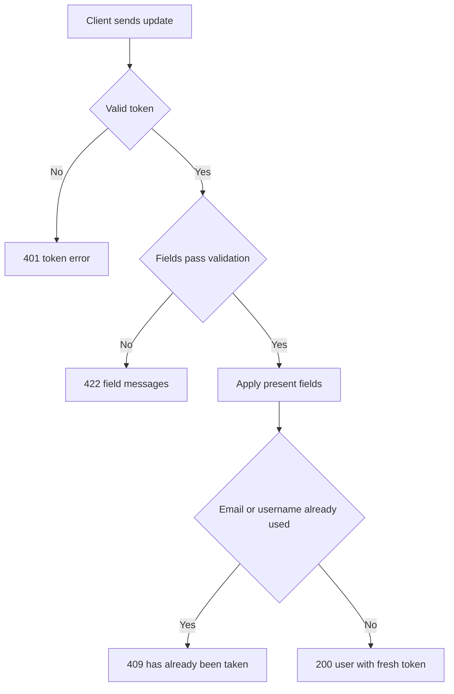

# Current user update
<!-- Read ../../index.md first. After changing this document, add an entry to ../../log.md -->

## Purpose
This document owns PUT /api/user, which changes the signed-in user's email, username, password, image or bio and returns the updated account with a fresh token. Reading the account is owned by [Current user read](current-user.md). The endpoint requires authentication as described in [Authentication token](../authentication-token.md).

## Current behavior
### Update request
- The client sends {"user": {…}} with any subset of email, username, password, image and bio.
- If the user object is missing, the server responds with status 422 under the key "user".
- A field that the request leaves out keeps its stored value.
- If the user object has no fields, the server changes nothing and returns the current account.

### Email and username changes
- If email or username is present, the server trims it and stores the trimmed value.
- If email or username is present but blank after trimming, the server responds with status 422 and "can't be blank" under that field.
- If another account already uses the new email or username, the server responds with status 409 as described in [Account email and username uniqueness](registration.md#account-email-and-username-uniqueness).

### Password change
- If password is present, the server trims it and stores a bcrypt hash of the trimmed value.
- If the trimmed password has fewer than 8 characters, the server responds with status 422 and "must be at least 8 characters long" under password.
- Tokens issued before the password change stay valid until they expire.

### Image and bio changes
- If image or bio is a non-empty string, the server stores it as sent.
- If image or bio is an empty string or null, the server clears the stored value, and the field is null in responses.

### Update response
- On success, the server responds with status 200 and {"user": {"id", "email", "username", "bio", "image", "token"}} with a newly issued token.

## Flow
The diagram shows the update request from validation to the response.

Only the fields present in the request change, and every successful update returns a fresh token.

## Policies
### Updated password minimum length
When an update contains a password, the trimmed password must have 8 or more characters; otherwise the server responds with 422 and "must be at least 8 characters long". A code comment cites NIST 800-63B section 5.1.1.2 as the basis. No test covers this rule.
[needs confirmation] Is the 8-character minimum after trimming the intended password rule for account update?

### Partial account update
The server changes only the fields present in the update request and keeps every other stored value. An empty or null image or bio clears the stored value to null, while an empty email, username or password is rejected with 422. No test covers this rule.
[needs confirmation] Is clearing image and bio with an empty string or null intended, and should an empty email or username be rejected rather than ignored?

### Existing tokens after a password change
Changing the password does not invalidate tokens issued earlier; every earlier token stays valid until its 60-day expiry.
[needs confirmation] Should a password change revoke tokens issued before it?

## Evidence
- `server/routes/api/user/index.put.ts` — validates the update, applies only the present fields, hashes a new password, maps duplicates to 409 and returns a fresh token
- `server/schemas/user.schema.ts` — update fields, the 8-character password minimum and the conversion of empty image and bio to null
- `server/utils/hash-password.ts` — hashes the new password
- `server/utils/prisma-errors.ts` — converts a duplicate email or username into 409

## Open questions
- [needs confirmation] [Updated password minimum length](#updated-password-minimum-length) — Is the 8-character minimum after trimming the intended password rule for account update?
- [needs confirmation] [Partial account update](#partial-account-update) — Is clearing image and bio with an empty string or null intended, and should an empty email or username be rejected rather than ignored?
- [needs confirmation] [Existing tokens after a password change](#existing-tokens-after-a-password-change) — Should a password change revoke tokens issued before it?

## Related
- [Users API overview](overview.md)
- [User registration](registration.md)
- [Current user read](current-user.md)
- [Authentication token](../authentication-token.md)
- [HTTP transport and error responses](../http-transport.md)
