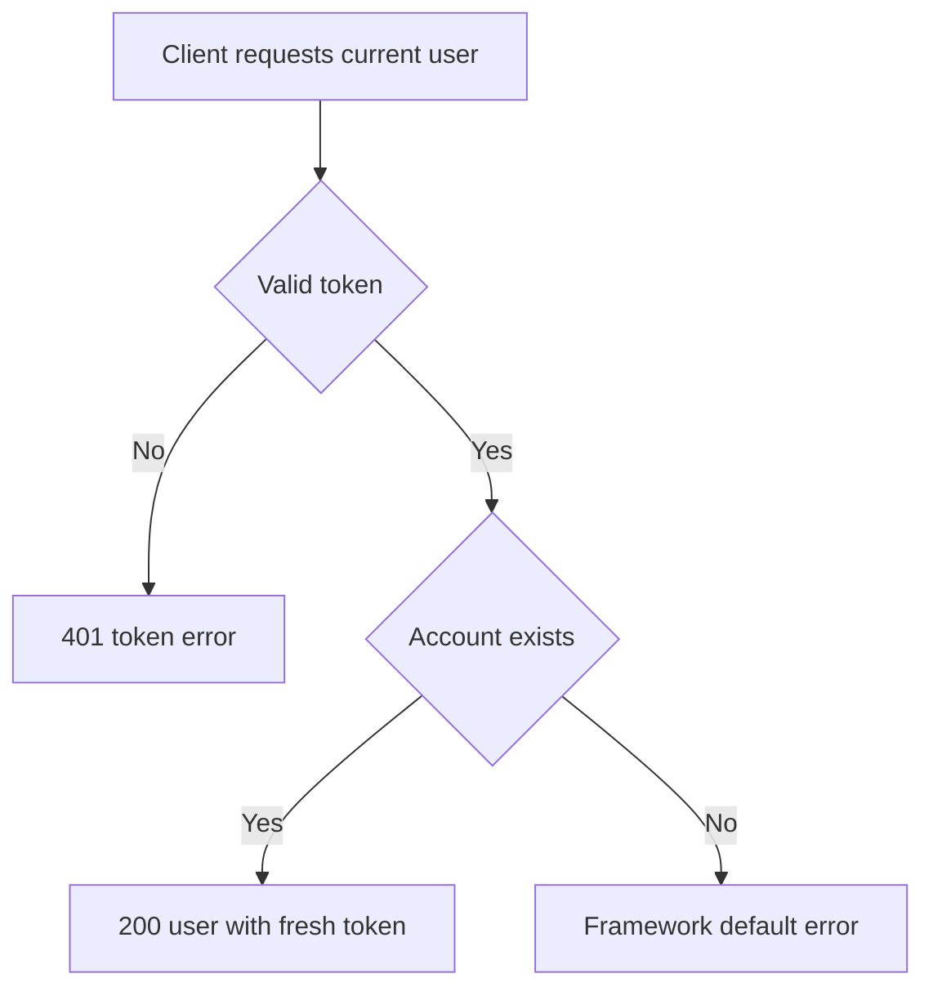

# Current user read
<!-- Read ../../index.md first. After changing this document, add an entry to ../../log.md -->

## Purpose
This document owns GET /api/user, which returns the signed-in user's own account with a fresh token. Changing the account is owned by [Current user update](current-user-update.md). The endpoint requires authentication as described in [Authentication token](../authentication-token.md).

## Current behavior
### Account lookup
- If the request carries no valid token, the server rejects it as described in [Authentication token](../authentication-token.md#missing-token-rejection).
- The server loads the account whose id the token holds.

### Current user response
- The server responds with status 200 and {"user": {"id", "email", "username", "bio", "image", "token"}}.
- The token in the response is newly issued on every call and expires 60 days later.
- If the account that the token names no longer exists, the server fails to build the response, and the result falls to [Unhandled server error response](../http-transport.md#unhandled-server-error-response).

## Flow
The diagram shows the current user read.

A valid token for an existing account always returns the account with a fresh token.

## Policies
### Current user token refresh
Every successful current user read returns a newly issued token with a new 60-day lifetime, so a client that reads its account regularly never reaches token expiry.
[needs confirmation] Is issuing a fresh token on every current user read intended?

### Current user read for a deleted account
When the token is valid but its account no longer exists, the server does not return a 404 or 401 error and the framework's default error handling answers instead.
[needs confirmation] What should the server return when a valid token names an account that no longer exists?

## Evidence
- `server/routes/api/user/index.get.ts` — loads the signed-in account and returns it with a fresh token
- `server/auth-event-handler.ts` — requires a token before the endpoint runs
- `server/utils/generate-token.ts` — issues the fresh token

## Open questions
- [needs confirmation] [Current user token refresh](#current-user-token-refresh) — Is issuing a fresh token on every current user read intended?
- [needs confirmation] [Current user read for a deleted account](#current-user-read-for-a-deleted-account) — What should the server return when a valid token names an account that no longer exists?

## Related
- [Users API overview](overview.md)
- [User registration](registration.md)
- [Current user update](current-user-update.md)
- [Authentication token](../authentication-token.md)
