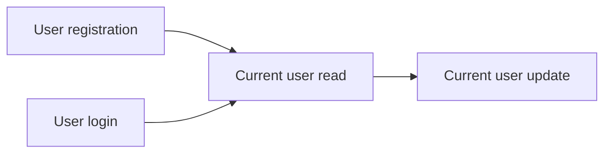

# Users API
<!-- Read ../../index.md first. After changing this document, add an entry to ../../log.md -->

## Purpose
This area owns the account endpoints: registration, login, and reading and updating the signed-in user's own account. Each of them returns the account object with a newly issued token. Viewing other users and following them is owned by the [Profiles API](../profiles/overview.md), and the token rules are owned by [Authentication token](../authentication-token.md).

## Flow
The diagram shows the order in which a user meets the account endpoints.

A user enters through registration or login, and both return a token that the current user endpoints require.

## Documents
- [User registration](registration.md) — POST /api/users, account creation, and the uniqueness, password and account response rules shared by every account endpoint
- [User login](login.md) — POST /api/users/login, email and password sign-in
- [Current user read](current-user.md) — GET /api/user, the signed-in user's account with a fresh token
- [Current user update](current-user-update.md) — PUT /api/user, partial changes to email, username, password, image and bio

## Related
- [API overview](../overview.md)
- [Spec index](../../index.md)
