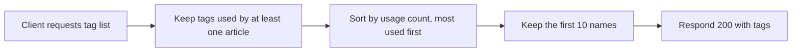

# Tag list
<!-- Read ../../index.md first. After changing this document, add an entry to ../../log.md -->

## Purpose
This document owns GET /api/tags, which returns the most used tag names. How tags are attached to articles is owned by [Article creation](article-create.md#article-tag-name-handling). The endpoint allows anonymous viewers as described in [Authentication token](../authentication-token.md), and the list is the same for anonymous and signed-in viewers.

## Current behavior
- The server considers only tags that at least one article uses.
- The server sorts those tags by the number of articles that use them, most used first.
- The server applies the limit after sorting and returns at most 10 tag names.
- The server does not define an order for tags that the same number of articles use.
- The server returns the same list to every viewer and does not paginate it.
- The server responds with status 200 and {"tags": ["<name>"…]}.
- If no article uses a tag, the list is empty.

## Flow
The diagram shows how the server builds the tag list for any viewer.

The server sorts before it applies the 10-tag limit, and tags with the same usage count have no defined order. When no article uses a tag, the response holds an empty list.

## Policies
### Popular tag list
The tag list holds at most 10 names of tags used by at least one article, sorted by the number of articles that use each tag, most used first, and the server applies the 10-tag limit after sorting. The limit keeps the tag sidebar short. The order of tags used by the same number of articles is intentionally undefined, so clients must not rely on it, while existing clients may rely on the most-used-first order. The list is the same for every viewer and has no pagination. No test covers this rule. (decision: [2026-11-03](../../log.md#2026-11-03-decision--popular-tag-list-most-used-first-stays-ties-are-undefined-10-tags-are-cut-after-sorting-and-every-viewer-gets-the-same-unpaginated-list))

## Evidence
- `server/routes/api/tags/index.get.ts` — selects tags used by at least one article, sorts them by usage and returns at most 10 names
- `prisma/schema.prisma` — unique tag names and the relation between tags and articles

## Open questions
None

## Related
- [Articles API overview](overview.md)
- [Article creation](article-create.md)
- [Article update](article-update.md)
- [Article deletion](article-delete.md)
