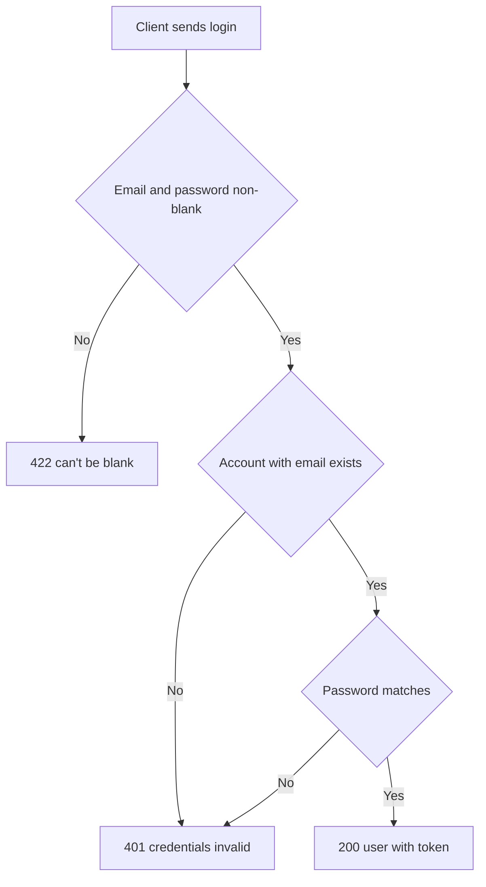

# User login
<!-- Read ../../index.md first. After changing this document, add an entry to ../../log.md -->

## Purpose
This document owns POST /api/users/login, which signs an existing user in with email and password and returns a new token. Account creation is owned by [User registration](registration.md). The endpoint does not require authentication.

## Current behavior
### Login request
- The client sends {"user": {"email", "password"}}.
- If email or password is blank after trimming, the server responds with status 422 and "can't be blank" under that field.
- The server does not check the email format, as described in [Email format](registration.md#email-format).
- The server trims the password before comparing it, following [Password trimming and hashing](registration.md#password-trimming-and-hashing).

### Credential check
- The server looks up the account whose stored email equals the trimmed email exactly.
- If an account is found, the server compares the password with the stored hash.

### Login response
- If the email and password match, the server responds with status 200 and {"user": {"email", "username", "bio", "image", "token"}}.
- The login response has no id field, as described in [User id in account responses](registration.md#user-id-in-account-responses).
- If no account has the email, or the password does not match, the server responds with status 401 and {"errors": {"credentials": ["invalid"]}}.

## Flow
The diagram shows the login request from validation to the response.

An unknown email and a wrong password end in the same 401 response.

## Policies
### Login credential matching
Login finds the account by an exact match of the trimmed email and compares the trimmed password with the stored bcrypt hash. An unknown email and a wrong password both produce status 401 with {"errors": {"credentials": ["invalid"]}}, so the response does not reveal whether the email exists. No test covers this rule, and the server applies no limit on repeated failed attempts.
[needs confirmation] Is the identical 401 response for unknown email and wrong password intended, should the email match ignore letter case, and should repeated failed attempts be limited?

## Evidence
- `server/routes/api/users/login.post.ts` — validates the request, finds the account by email, compares the password and returns the user with a token or 401
- `server/schemas/user.schema.ts` — login fields, trimming and the "can't be blank" rule
- `server/utils/generate-token.ts` — issues the token returned on success

## Open questions
- [needs confirmation] [Login credential matching](#login-credential-matching) — Is the identical 401 response for unknown email and wrong password intended, should the email match ignore letter case, and should repeated failed attempts be limited?

## Related
- [Users API overview](overview.md)
- [User registration](registration.md)
- [Authentication token](../authentication-token.md)
