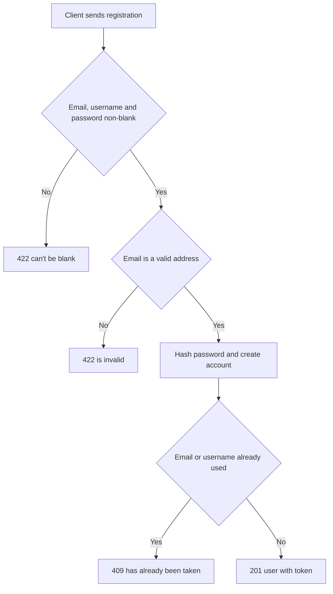

# User registration
<!-- Read ../../index.md first. After changing this document, add an entry to ../../log.md -->

## Purpose
This document owns POST /api/users, which creates an account and signs the new user in. It also owns the rules shared by every account endpoint: email and username uniqueness, password trimming and hashing, and the user id in account responses. Login is owned by [User login](login.md), and changes to an existing account by [Current user update](current-user-update.md). The endpoint does not require authentication.

## Current behavior
### Registration request
- The client sends {"user": {"email", "username", "password", "image", "bio"}}; image and bio are optional.
- The server trims email, username and password and stores the trimmed values.
- If email, username or password is blank after trimming, the server responds with status 422 and "can't be blank" under that field, following [Request body validation error mapping](../http-transport.md#request-body-validation-error-mapping).
- If the trimmed email is not a valid address, the server responds with status 422 and {"errors": {"email": ["is invalid"]}}, as described in [Email format](#email-format).
- The server requires no minimum password length beyond a non-blank value.

### Account creation
- The server stores a bcrypt hash of the password, never the password itself.
- If image or bio is a non-empty string, the server stores it as sent, without trimming.
- If image or bio is absent or an empty string, the server stores no value, and the field is null in responses.

### Registration response
- On success, the server responds with status 201 and {"user": {"id", "email", "username", "bio", "image", "token"}}.
- The token is a newly issued [Authentication token](../authentication-token.md#token-lifetime).

### Duplicate email or username
- If another account already uses the email, the server responds with status 409 and {"errors": {"email": ["has already been taken"]}}.
- If another account already uses the username, the server responds with status 409 and {"errors": {"username": ["has already been taken"]}}.
- If the conflicting field cannot be identified, the body lists both messages, following [Unique conflict field selection](../http-transport.md#unique-conflict-field-selection).

## Flow
The diagram shows the registration request from validation to the response.

A registration ends in a 422 validation error (blank field or invalid email), a 409 conflict, or a 201 response that signs the user in.

## Policies
### Registration required fields
Registration requires email, username and password to be non-blank after trimming, and blank values are rejected with 422 "can't be blank". The server accepts a password of any non-blank length, while [Updated password minimum length](current-user-update.md#updated-password-minimum-length) requires 8 characters on update. No test covers these rules.
[needs confirmation] Should registration apply the same 8-character password minimum as account update?

### Email format
Registration, login and account update require the email to be a valid address after trimming. An email that fails the check is rejected with status 422 and {"errors": {"email": ["is invalid"]}} before the server hashes a password, looks up an account or writes to the database. On account update, the check applies only when the request contains an email. All three endpoints use the same check. No test covers this rule.

### Accepted email address forms
The server accepts the addresses that the validation library's built-in email rule accepts, and the schema adds no length limit or domain restriction. The schema applies the blank check and the format check to the same email field, and the validation error mapping lists every failing message under one key, so no test or rule settles whether a blank email reports "can't be blank" alone or together with "is invalid".
[needs confirmation] Which addresses should count as valid, and should a blank email report only "can't be blank"?

### Account email and username uniqueness
Every account has a unique email and a unique username. Registration and account update reject a value that another account already uses with status 409 and "has already been taken" under the conflicting field. The server compares values exactly as stored after trimming and does not lowercase them, so values that differ only in letter case count as different. No test covers this endpoint mapping.
[needs confirmation] Should email and username uniqueness ignore letter case?

### Password trimming and hashing
Registration, login and account update trim surrounding whitespace from the password before hashing or comparing it. The server hashes passwords with bcrypt using the cost in the BCRYPT_SALT_ROUNDS environment variable, or 10 when that variable is absent, zero or not a number.
[needs confirmation] Is removing surrounding whitespace from passwords intended, and what is the basis of the default bcrypt cost of 10?

### Optional profile fields at registration
Registration stores image and bio only when they are non-empty strings; otherwise both stay null. The initial migration declares a default image URL and a demo column for users that the current database schema does not declare.
[needs confirmation] Should a new account without an image get a default image, and which is right for the user table, the initial migration or the current schema?

### User id in account responses
Registration, current user read and current user update responses include the user's numeric id, while the login response does not.
[needs confirmation] Is exposing the numeric user id in account responses intended, and should every account response contain the same fields?

## Evidence
- `server/routes/api/users/index.post.ts` — validates the request, hashes the password, creates the account, returns 201 with a token and maps duplicates to 409
- `server/schemas/user.schema.ts` — registration fields, trimming, the "can't be blank" rule and the email format rule
- `server/utils/hash-password.ts` — bcrypt hashing with the configurable cost
- `server/utils/prisma-errors.ts` — converts the duplicate email or username into 409
- `server/utils/prisma-errors.test.ts` — tests the 409 conversion with the email and username messages
- `prisma/schema.prisma` — unique email and username and optional image and bio
- `prisma/migrations/20241009081140_init/migration.sql` — initial user table with a default image and a demo column
- `../docs/raw/realworld-b8a37f1-validate-email-format.diff` — upstream API spec change: hurl cases that expect 422 "is invalid" for a malformed email on registration, login and account update, and the email format on the OpenAPI user objects

## Open questions
- [needs confirmation] [Registration required fields](#registration-required-fields) — Should registration apply the same 8-character password minimum as account update?
- [needs confirmation] [Accepted email address forms](#accepted-email-address-forms) — Which addresses should count as valid, and should a blank email report only "can't be blank"?
- [needs confirmation] [Account email and username uniqueness](#account-email-and-username-uniqueness) — Should email and username uniqueness ignore letter case?
- [needs confirmation] [Password trimming and hashing](#password-trimming-and-hashing) — Is removing surrounding whitespace from passwords intended, and what is the basis of the default bcrypt cost of 10?
- [needs confirmation] [Optional profile fields at registration](#optional-profile-fields-at-registration) — Should a new account without an image get a default image, and which is right for the user table, the initial migration or the current schema?
- [needs confirmation] [User id in account responses](#user-id-in-account-responses) — Is exposing the numeric user id in account responses intended, and should every account response contain the same fields?

## Related
- [Users API overview](overview.md)
- [User login](login.md)
- [Current user read](current-user.md)
- [Current user update](current-user-update.md)
- [Authentication token](../authentication-token.md)
- [HTTP transport and error responses](../http-transport.md)
